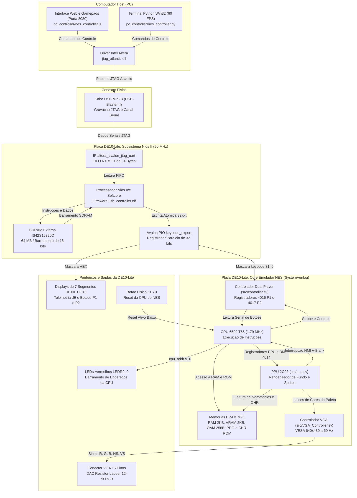
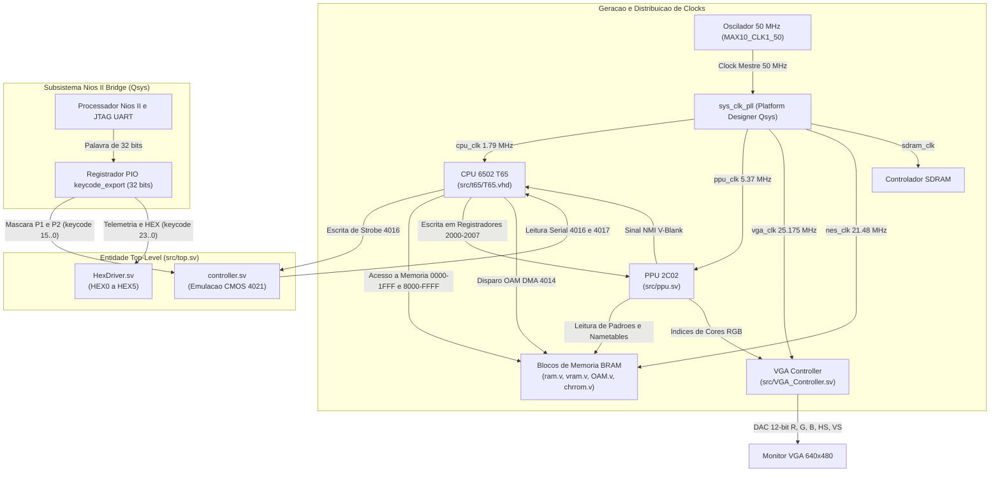
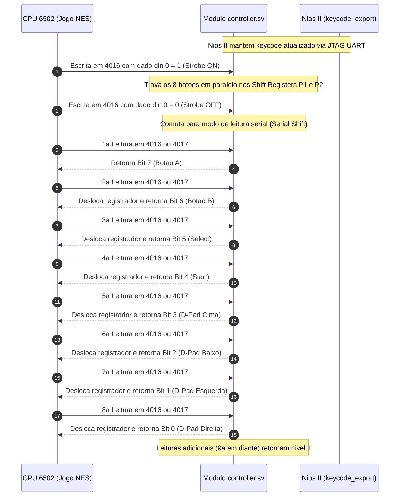

# NES-FPGA: Emulador de Nintendo Entertainment System em SystemVerilog

Emulador completo de console Nintendo Entertainment System (NES) de 8 bits implementado em **SystemVerilog** para o FPGA **Intel/Altera MAX 10 (`10M50DAF484C7G`)** na placa de desenvolvimento **Terasic DE10-Lite**.

O projeto conta com arquitetura de processamento híbrida: um emulador de hardware em SystemVerilog executando a CPU 6502 e a PPU do NES em sincronia de ciclo, integrado a um processador auxiliar softcore **Altera Nios II/e** que atua como ponte inteligente de entrada/saída (I/O bridge) de ultra-baixa latência via barramento **JTAG UART**, permitindo jogar em modo **Dual Player (2 jogadores simultâneos)** a partir do PC Host via navegadores web (com suporte a Gamepads USB/Bluetooth) ou scripts nativos de alta performance em Python e Node.js.

---


---

## Sumário

1. [Visão Geral da Arquitetura](#1-visão-geral-da-arquitetura)
2. [Diagramas de Arquitetura e Fluxo (Mermaid Nativos)](#2-diagramas-de-arquitetura-e-fluxo-mermaid-nativos)
   - [2.1 Topologia Global do Sistema](#21-topologia-global-do-sistema)
   - [2.2 Interconexão de Módulos de Hardware no Silício](#22-interconexão-de-módulos-de-hardware-no-silício)
   - [2.3 Diagrama de Temporização de Leitura dos Controles (Strobe)](#23-diagrama-de-temporização-de-leitura-dos-controles-strobe)
3. [Estrutura de Diretórios e Padronização](#3-estrutura-de-diretórios-e-padronização)
4. [Módulo a Módulo de Hardware (SystemVerilog / HDL)](#4-módulo-a-módulo-de-hardware-systemverilog--hdl)
   - [4.1 Módulo Top-Level (`src/top.sv`)](#41-módulo-top-level-srctopsv)
   - [4.2 Módulo de Controle Dual Player (`src/controller.sv`)](#42-módulo-de-controle-dual-player-srccontrollersv)
   - [4.3 Processador PPU e Renderizador (`src/ppu.sv`)](#43-processador-ppu-e-renderizador-srcppusv)
   - [4.4 Controlador de Vídeo VGA (`src/VGA_Controller.sv`)](#44-controlador-de-vídeo-vga-srcvga_controllersv)
   - [4.5 Decodificadores de Display (`src/HexDriver.sv`)](#45-decodificadores-de-display-srchexdriversv)
   - [4.6 Sincronizadores Anti-Metaestabilidade (`src/sync.sv`)](#46-sincronizadores-anti-metaestabilidade-srcsyncsv)
   - [4.7 Memórias Embutidas BRAM (`src/ram/`, `src/vram/`, `src/OAM/`, `src/chrrom/`)](#47-memórias-embutidas-bram-srcram-srcvram-srcoam-srcchrrom)
5. [O Processador do Emulador: CPU 6502 (Ricoh 2A03 Core)](#5-o-processador-do-emulador-cpu-6502-ricoh-2a03-core)
   - [5.1 Microarquitetura e Temporização](#51-microarquitetura-e-temporização)
   - [5.2 Registradores Internos e Flags](#52-registradores-internos-e-flags)
   - [5.3 Barramentos e Ciclo de Instrução](#53-barramentos-e-ciclo-de-instrução)
   - [5.4 Vetores de Interrupção (NMI, RESET, IRQ)](#54-vetores-de-interrupção-nmi-reset-irq)
   - [5.5 OAM Direct Memory Access (DMA em `$4014`)](#55-oam-direct-memory-access-dma-em-4014)
6. [O Processador Auxiliar: Softcore Altera Nios II/e (Qsys)](#6-o-processador-auxiliar-softcore-altera-nios-iie-qsys)
   - [6.1 Papel Arquitetural](#61-papel-arquitetural)
   - [6.2 Interconexão Avalon Memory-Mapped (Avalon-MM)](#62-interconexão-avalon-memory-mapped-avalon-mm)
   - [6.3 Memória SDRAM Externa de 64 MB](#63-memória-sdram-externa-de-64-mb)
   - [6.4 Núcleo IP `altera_avalon_jtag_uart`](#64-núcleo-ip-altera_avalon_jtag_uart)
   - [6.5 Barramento Paralelo PIO (`keycode_export`)](#65-barramento-paralelo-pio-keycode_export)
7. [O Firmware do Nios II em C (`main.c`)](#7-o-firmware-do-nios-ii-em-c-mainc)
   - [7.1 Máquina de Estados de Recepção Serial](#71-máquina-de-estados-de-recepção-serial)
   - [7.2 Polling de Alta Frequência Não-Bloqueante](#72-polling-de-alta-frequência-não-bloqueante)
   - [7.3 Suporte Concorrente a USB Físico (MAX3421E Shield)](#73-suporte-concorrente-a-usb-físico-max3421e-shield)
   - [7.4 Montagem da Palavra de 32 Bits para o Hardware](#74-montagem-da-palavra-de-32-bits-para-o-hardware)
8. [O Sistema de Controles e Registradores `$4016` / `$4017`](#8-o-sistema-de-controles-e-registradores-4016--4017)
   - [8.1 Emulação do Chip CMOS 4021 do NES](#81-emulação-do-chip-cmos-4021-do-nes)
   - [8.2 Mecanismo de Strobe e Shift Registers](#82-mecanismo-de-strobe-e-shift-registers)
   - [8.3 Desacoplamento Assíncrono Combinacional](#83-desacoplamento-assíncrono-combinacional)
9. [O Sistema de Vídeo VGA e PPU](#9-o-sistema-de-vídeo-vga-e-ppu)
   - [9.1 Temporização de Vídeo VESA 640x480 @ 60 Hz](#91-temporização-de-vídeo-vesa-640x480--60-hz)
   - [9.2 Escalonamento 2x (Upscaling de 256x240 para 640x480)](#92-escalonamento-2x-upscaling-de-256x240-para-640x480)
   - [9.3 Conversão da Paleta NES para DAC 12-Bit RGB](#93-conversão-da-paleta-nes-para-dac-12-bit-rgb)
   - [9.4 Renderização de Planos (Background e Sprites)](#94-renderização-de-planos-background-e-sprites)
10. [Memórias e Mapeamento de Barramentos](#10-memórias-e-mapeamento-de-barramentos)
    - [10.1 Mapa de Memória da CPU ($0000-$FFFF)](#101-mapa-de-memória-da-cpu-0000-ffff)
    - [10.2 Mapa de Memória da PPU ($0000-$3FFF)](#102-mapa-de-memória-da-ppu-0000-3fff)
    - [10.3 Arquivos de Inicialização de Memória MIF (`prg.mif`, `chr.mif`)](#103-arquivos-de-inicialização-de-memória-mif-prgmif-chrmif)
11. [Comunicações de Ponta a Ponta (Host PC -> FPGA)](#11-comunicações-de-ponta-a-ponta-host-pc---fpga)
    - [11.1 Fluxo Físico e Lógico dos Pacotes](#111-fluxo-físico-e-lógico-dos-pacotes)
    - [11.2 Protocolos Suportados (Binário e ASCII HEX)](#112-protocolos-suportados-binário-e-ascii-hex)
    - [11.3 Telemetria nos Displays de 7 Segmentos e LEDs](#113-telemetria-nos-displays-de-7-segmentos-e-leds)
12. [Como Adicionar Novos Jogos Funcionais à Biblioteca (`cart_init/`)](#12-como-adicionar-novos-jogos-funcionais-à-biblioteca-cart_init)
    - [12.1 Pré-requisitos da ROM iNES](#121-pré-requisitos-da-rom-ines)
    - [12.2 Conversão Automática via Script (`nes_to_mif.js` / `nes_to_mif.py`)](#122-conversão-automática-via-script-nes_to_mifjs--nes_to_mifpy)
    - [12.3 Cadastrando na Biblioteca Permanente (`cart_init/games/`)](#123-cadastrando-na-biblioteca-permanente-cart_initgames)
    - [12.4 Método Legado via Hex Dump do VSCode e Python Parser](#124-método-legado-via-hex-dump-do-vscode-e-python-parser)
13. [Documentação Exaustiva de Scripts (JavaScript, Python e Batch)](#13-documentação-exaustiva-de-scripts-javascript-python-e-batch)
    - [13.1 Scripts na Raiz do Projeto](#131-scripts-na-raiz-do-projeto)
    - [13.2 Scripts do Gerenciador de Cartuchos (`cart_init/`)](#132-scripts-do-gerenciador-de-cartuchos-cart_init)
    - [13.3 Scripts da Ponte de Comunicação (`pc_controller/`)](#133-scripts-da-ponte-de-comunicação-pc_controller)
14. [Limitações Técnicas Conhecidas (Issues & Roadmap de Engenharia)](#14-limitações-técnicas-conhecidas-issues--roadmap-de-engenharia)
15. [Guia Rápido de Execução e Mapeamento de Teclas](#15-guia-rápido-de-execução-e-mapeamento-de-teclas)
16. [Documentos de Referência Complementares](#16-documentos-de-referência-complementares)

---

## 1. Visão Geral da Arquitetura

O sistema integra hardware programável, processador embutido, firmware em tempo real e aplicações no host:

- **Core do NES em SystemVerilog:** Executa em hardware síncrono a CPU 6502 (core T65 em VHDL) e a PPU (Picture Processing Unit em SystemVerilog), gerando vídeo VGA nativo a 60 quadros por segundo com resolução escalonada de 640x480.
- **Processador Auxiliar Nios II/e:** Processador softcore RISC de 32 bits sintetizado no FPGA que executa o firmware C (`usb_controller.elf`) na memória SDRAM externa de 64 MB, gerenciando o canal serial JTAG UART sem consumir ciclos de processamento da CPU do jogo.
- **Ponte de Controle Dual Player:** Suporte nativo a 2 jogadores independentes (Player 1 e Player 2) utilizando o mesmo cabo USB de gravação do FPGA através do IP `altera_avalon_jtag_uart` e da biblioteca `jtag_atlantic.dll`.
- **Servidores Host Multiplataforma:** Aplicações prontas em Node.js (Web/WebSocket com suporte a gamepads USB/Bluetooth) e Python nativo (Win32 polling a 60 FPS com latência inferior a 5 ms).
- **Biblioteca de 57 Jogos Mapper 0 (NROM):** Catálogo integrado com suporte a troca instantânea de ROMs e compilação rápida de bitstream em ~15 segundos.

---

## 2. Diagramas de Arquitetura e Fluxo (Mermaid Nativos)

### 2.1 Topologia Global do Sistema



---

### 2.2 Interconexão de Módulos de Hardware no Silício



---

### 2.3 Diagrama de Temporização de Leitura dos Controles (Strobe)



---

## 3. Estrutura de Diretórios e Padronização

A organização física dos componentes do projeto é padronizada da seguinte forma:

| Diretório / Arquivo | Descrição do Conteúdo |
| :--- | :--- |
| **[`src/`](file:///C:/HDL/t4/NES-FPGA/src/)** | Código-fonte do hardware do NES em SystemVerilog/VHDL (`top.sv`, `controller.sv`, `ppu.sv`, `VGA_Controller.sv`, `HexDriver.sv`, `sync.sv`, CPU `t65/`, blocos de memória `ram/`, `vram/`, `OAM/`, `chrrom/`). |
| **[`qsys/`](file:///C:/HDL/t4/NES-FPGA/qsys/)** | Definição do sistema Platform Designer (`NIOSIIe.qsys`), topologia de barramentos Avalon-MM, arquivos gerados de síntese e árvore de software. |
| **[`qsys/software/usb_controller/`](file:///C:/HDL/t4/NES-FPGA/qsys/software/usb_controller/)** | Código-fonte em C (`main.c`) do firmware do Nios II, headers de hardware (`system.h`), drivers do shield USB e scripts Makefile. |
| **[`pc_controller/`](file:///C:/HDL/t4/NES-FPGA/pc_controller/)** | Aplicações de controle no PC Host: servidor Web (`nes_controller.js`), cliente Python Win32 (`nes_controller.py`), ponte JTAG Atlantic (`jtag_bridge.py`), ferramenta de diagnóstico (`test_jtag_uart.py`) e interface gráfica em [`pc_controller/web/`](file:///C:/HDL/t4/NES-FPGA/pc_controller/web/). |
| **[`cart_init/`](file:///C:/HDL/t4/NES-FPGA/cart_init/)** | Catálogo com **57 jogos clássicos de NES** (todos Mapper 0 / NROM), script de troca de jogos [`switch_game.js`](file:///C:/HDL/t4/NES-FPGA/cart_init/switch_game.js), gerador de memória [`nes_to_mif.js`](file:///C:/HDL/t4/NES-FPGA/cart_init/nes_to_mif.js) e parsers legados em Python. |
| **[`eclipse/`](file:///C:/HDL/t4/NES-FPGA/eclipse/)** | Workspace do ambiente gráfico Nios II Software Build Tools for Eclipse. |
| **[`output_files/`](file:///C:/HDL/t4/NES-FPGA/output_files/)** | Arquivos finais de compilação do Quartus Prime, incluindo o bitstream compilado [`output_files/NES.sof`](file:///C:/HDL/t4/NES-FPGA/output_files/NES.sof). |
| **[`compile_project.bat`](file:///C:/HDL/t4/NES-FPGA/compile_project.bat)** | Script de compilação automatizada do projeto com detecção inteligente de toolchains (Quartus 18.1 / Nios II), suporte a `--flash`, `--firmware`, `--game <slug>`, `--quick` e `--clean`. |
| **[`build_all.bat`](file:///C:/HDL/t4/NES-FPGA/build_all.bat)** | Atalho direto repassando parâmetros para `compile_project.bat`. |
| **[`run_web_controller.bat`](file:///C:/HDL/t4/NES-FPGA/run_web_controller.bat)** | Script de inicialização com 1 clique do servidor Web de controle Dual Player (porta 8080). |
| **[`run_python_controller.bat`](file:///C:/HDL/t4/NES-FPGA/run_python_controller.bat)** | Script de inicialização com 1 clique do controlador nativo em Python a 60 FPS. |
| **[`test_jtag_uart.bat`](file:///C:/HDL/t4/NES-FPGA/test_jtag_uart.bat)** | Script de diagnóstico ponta a ponta do canal JTAG UART e medição de latência RTT. |
| **[`COMPILACAO_DO_ZERO.md`](file:///C:/HDL/t4/NES-FPGA/COMPILACAO_DO_ZERO.md)** | Manual detalhado passo a passo de compilação e configuração a partir de um PC recém-formatado. |
| **[`BUILD_GUIDE.md`](file:///C:/HDL/t4/NES-FPGA/BUILD_GUIDE.md)** | Guia técnico aprofundado cobrindo o fluxo de compilação manual e a arquitetura. |
| **[`COMPATIBLE_GAMES.md`](file:///C:/HDL/t4/NES-FPGA/COMPATIBLE_GAMES.md)** | Lista exaustiva dos 57 jogos NROM compatíveis com detalhes de espelhamento, CRC32 e links. |

---

## 4. Módulo a Módulo de Hardware (SystemVerilog / HDL)

### 4.1 Módulo Top-Level (`src/top.sv`)
Arquivo mestre de integração do projeto. Realiza:
- **Distribuição de Clocks:** Recebe o clock oscilador principal da DE10-Lite (`MAX10_CLK1_50`, 50 MHz) e conecta-se à PLL do Qsys para receber:
  - `cpu_clk` (~1.7897 MHz): Clock da CPU 6502 do NES.
  - `ppu_clk` (~5.369 MHz): Clock da PPU (exatamente 3x o clock da CPU, relação fundamental do padrão NTSC).
  - `vga_clk` (25.175 MHz): Clock de pixel para sincronismo de vídeo VESA 640x480.
  - `nes_clk` (21.477 MHz): Clock de barramento mestre de memória.
  - `sdram_clk_clk`: Clock defasado em fase para atender o timing da SDRAM externa da placa.
- **Roteamento de Barramentos:** Mapeia os barramentos de endereços (`cpu_addr[15:0]`) e dados da CPU (`cpu_din`, `cpu_dout`), realizando a decodificação de memória entre RAM interna (`$0000-$1FFF`), registradores da PPU (`$2000-$3FFF`), registradores de controle (`$4016` e `$4017`) e PRG-ROM (`$8000-$FFFF`).
- **Engine OAM DMA (`$4014`):** Monitora escritas no endereço `$4014` e executa a máquina de transferência DMA em hardware, bloqueando o avanço da CPU (`cpu_enable = ~dma`) enquanto copia 256 bytes consecutivos da RAM para a OAM dos sprites na PPU.
- **Condução dos Displays HEX:** Extrai nibbles da palavra de 32 bits `keycode` gerada pelo Nios II e alimenta os módulos [`HexDriver`](file:///C:/HDL/t4/NES-FPGA/src/HexDriver.sv) com decodificação direta para `HEX0` a `HEX5`.

---

### 4.2 Módulo de Controle Dual Player (`src/controller.sv`)
Módulo responsável por emular fielmente os chips de registrador de deslocamento **CMOS 4021** presentes nos controles originais da Nintendo:
- **Entradas e Saídas:**
  - `clk`: Clock da CPU 6502 (`cpu_clk`).
  - `addr[15:0]`: Barramento de endereços da CPU (decodifica `$4016` para P1 e `$4017` para P2).
  - `keycode[31:0]`: Máscara paralela vinda do Nios II (`[7:0]` para Player 1 e `[15:8]` para Player 2).
  - `wren`: Habilitação de escrita (`~cpu_read`).
  - `din[7:0]`: Barramento de escrita da CPU (`cpu_dout`).
  - `dout[7:0]`: Dado retornado para o barramento de leitura (`controller_dout`).
- **Arquitetura Assíncrona e Strobe:**
  - Possui dois shift registers de 8 bits independentes (`shift_reg1` e `shift_reg2`).
  - Quando a CPU grava `din[0] = 1` em `$4016`, ativa o `strobe` e carrega continuamente os botões nos shift registers em modo paralelo.
  - Quando a CPU grava `din[0] = 0` em `$4016`, o strobe cai para nível baixo e trava os estados dos botões.
  - A cada ciclo de leitura subseqüente em `$4016` (Player 1) ou `$4017` (Player 2), o bit mais significativo (MSB) é exposto na linha de dados e o registrador desloca 1 posição para a esquerda, preenchendo os bits seguintes com `'1'`.
  - A lógica combinacional de saída é completamente desacoplada: leituras em `$4016` nunca afetam o ponteiro ou registrador de `$4017`, permitindo suporte perfeito a 2 jogadores simultâneos.

---

### 4.3 Processador PPU e Renderizador (`src/ppu.sv`)
Emulação da Picture Processing Unit (Ricoh 2C02) do NES:
- **Registradores Internos Mapeados na CPU:**
  - `$2000` (`PPUCTRL`): Configuração de endereço de nametable base, incremento vertical/horizontal (+1 ou +32) e ativação de interrupção NMI no V-Blank.
  - `$2001` (`PPUMASK`): Habilitação de renderização de plano de fundo e sprites.
  - `$2002` (`PPUSTATUS`): Flags de status, incluindo Sprite 0 Hit e V-Blank flag (bit 7).
  - `$2003` (`OAMADDR`) e `$2004` (`OAMDATA`): Acesso sequencial à memória de sprites.
  - `$2005` (`PPUSCROLL`): Posição de rolagem horizontal (`scroll_x`) e vertical (`scroll_y`).
  - `$2006` (`PPUADDR`) e `$2007` (`PPUDATA`): Ponte de escrita/leitura nos 16 KB de espaço de endereçamento da PPU.
- **Interrupção NMI:** Gera pulso ativo na linha `nmi` ao atingir a linha vertical de varredura correspondente ao início do período de V-Blank (`DrawY == 480`).
- **Paleta de Cores Interna:** 32 registradores de paleta (`palette_mem[31:0]`) nos endereços `$3F00-$3F1F`, espelhados a cada 32 bytes até `$3FFF`.

---

### 4.4 Controlador de Vídeo VGA (`src/VGA_Controller.sv`)
Gera a base de tempo de varredura progressiva padrão **VESA 640x480 @ 60 Hz**:
- **Clock:** Alimentado por `vga_clk` a 25.175 MHz.
- **Contadores de Varredura:**
  - Contador Horizontal (`hc`): 0 a 799 (800 pixels totais por linha). Área ativa: 0 a 639. Pulso `hs` (ativo baixo) gerado nos pixels 656 a 751.
  - Contador Vertical (`vc`): 0 a 524 (525 linhas totais por quadro). Área ativa: 0 a 479. Pulso `vs` (ativo baixo) gerado nas linhas 490 a 491.
- **Sinais Fornecidos:** Coordenadas atuais `DrawX` (0-799) e `DrawY` (0-524), sinais de blanking `h_blank` e `v_blank`, e sincronismos `VGA_HS` e `VGA_VS`.

---

### 4.5 Decodificadores de Display (`src/HexDriver.sv`)
Converte dígitos binários de 4 bits (nibbles `0x0` a `0xF`) em sinais de 7 segmentos ativos em nível baixo (`active-low`) para os displays da placa DE10-Lite:
- Mapeia dígitos numéricos de `0` a `9` e caracteres hexadecimais `A`, `b`, `C`, `d`, `E`, `F`.
- Permite renderizar a telemetria `"dE"` nos displays superiores `HEX5` e `HEX4`.

---

### 4.6 Sincronizadores Anti-Metaestabilidade (`src/sync.sv`)
Evita condições de metaestabilidade ao cruzar sinais assíncronos das chaves mecânicas e botões externos da DE10-Lite para o domínio de clock digital do FPGA:
- Contém módulos sincronizadores de dois estágios (`sync2` para os botões `KEY[1:0]` e `sync10` para as chaves `SW[9:0]`) usando flip-flops em cascata sensíveis a `nes_clk`.

---

### 4.7 Memórias Embutidas BRAM (`src/ram/`, `src/vram/`, `src/OAM/`, `src/chrrom/`)
Instanciadas a partir dos blocos primitivos **M9K** de memória estática embutida no silício do FPGA MAX 10:
- **`ram.v` (CPU RAM):** Memória de porta simples de 2048 bytes (2 KB) com barramento de dados de 8 bits e barramento de endereços de 11 bits (espelhada no espaço `$0000-$1FFF`).
- **`vram.v` (PPU Video RAM):** Memória de 2048 bytes para as nametables do NES (espelhamento vertical ativado, mapeando as nametables 0 e 2 no bloco A e as nametables 1 e 3 no bloco B).
- **`OAM.v` (Sprite RAM):** Memória dual-port de 256 bytes (64 entradas x 4 bytes). A porta A é lida pelo pipeline de vídeo em `vga_clk` e a porta B é acessada pelo barramento da CPU / DMA em `nes_clk`.
- **`chrrom.v` (Pattern Tables):** Memória ROM síncrona de 8192 bytes (8 KB) contendo os tiles gráficos do jogo, inicializada automaticamente pelo arquivo [`chr.mif`](file:///C:/HDL/t4/NES-FPGA/chr.mif).

---

## 5. O Processador do Emulador: CPU 6502 (Ricoh 2A03 Core)

A CPU do NES é uma variante do clássico microprocessador MOS Technology 6502 (frequentemente referenciada como Ricoh 2A03 nas versões NTSC). No projeto, a CPU é instanciada através do core **T65** escrito em VHDL (arquivos em `src/t65/`).

### 5.1 Microarquitetura e Temporização
- **Frequência de Operação:** Opera a **~1.789773 MHz**, derivada pela PLL a partir do clock de 50 MHz da placa.
- **Clock por Ciclo:** Cada ciclo de instrução do 6502 consome entre 2 e 7 ciclos de clock de máquina, com leitura de opcode no primeiro ciclo (`T1`) e ciclos de busca de operandos / acesso à memória nos estados subsequentes (`T2` a `T7`).
- **Modo Decimal Desabilitado:** A Nintendo removeu fisicamente a circulação de carry em formato BCD (Binary Coded Decimal) do 6502 para evitar pagamento de royalties à MOS Technology. No módulo [`top.sv`](file:///C:/HDL/t4/NES-FPGA/src/top.sv#L140), o sinal `BCD_en` é fixado estritamente em `1'b0`, garantindo compatibilidade total com os binários comerciais do NES.

### 5.2 Registradores Internos e Flags
O modelo de programação do 6502 contém:
1. **Acumulador (`A` - 8 bits):** Registrador primário para todas as operações aritméticas da ALU e manipulações lógicas.
2. **Registradores de Índice (`X` e `Y` - 8 bits cada):** Utilizados para modos de endereçamento indexado (ex: `LDA $2000,X`), contadores e ponteiros de tabelas.
3. **Ponteiro de Pilha (`SP` - 8 bits):** Endereça a pilha (stack) do sistema alocada fixamente na página 1 da memória RAM (`$0100` a `$01FF`), operando em modo decrescente.
4. **Contador de Programa (`PC` - 16 bits):** Aponta para o endereço da próxima instrução a ser lida no espaço de 64 KB.
5. **Registrador de Status (`P` - 8 bits):** Contém as flags condicionais avaliadas pelas instruções de desvio (`BNE`, `BEQ`, `BCS`, etc.):
   - Bit 7: **N** (Negative - bit 7 do resultado)
   - Bit 6: **V** (Overflow - estouro aritmético em complemento de dois)
   - Bit 5: **-** (Sempre nível 1)
   - Bit 4: **B** (Break Command)
   - Bit 3: **D** (Decimal Mode - inoperante no NES)
   - Bit 2: **I** (Interrupt Disable - mascara IRQs)
   - Bit 1: **Z** (Zero - resultado nulo)
   - Bit 0: **C** (Carry - estouro sem sinal ou borrow em subtrações)

### 5.3 Barramentos e Ciclo de Instrução
O módulo conecta-se ao sistema através dos seguintes sinais:
- `A[23:0]`: Barramento de endereços. Apenas as 16 linhas inferiores (`[15:0]`) são roteadas para o espaço de memória do NES ($0000-$FFFF).
- `DI[7:0]`: Barramento de entrada de dados (lido de RAM, ROM ou I/O).
- `DO[7:0]`: Barramento de saída de dados (escrito pela CPU).
- `R_W_n`: Linha de controle (`1` = Leitura, `0` = Escrita).
- `enable`: Habilita a evolução do clock de máquina. É colocada em nível baixo (`0`) durante transferências de DMA para congelar a CPU.
- `rdy`: Sinal de parada de memória (Ready).

### 5.4 Vetores de Interrupção (NMI, RESET, IRQ)
A CPU do NES possui 3 vetores de 16 bits localizados no topo da memória PRG-ROM:
- **`$FFFA-$FFFB` (NMI - Non-Maskable Interrupt):** Disparado pela PPU na linha `cpu_nmi` no início de cada quadro de vídeo (V-Blank). É através desta interrupção que os jogos executam as rotinas de lógica de jogo, física e atualização de sprites/nametables a 60 quadros por segundo.
- **`$FFFC-$FFFD` (RESET Vector):** Lido pela CPU quando o sinal `cpu_reset` (`KEY[0]`) passa de nível baixo para nível alto. Carrega o endereço inicial do código do cartucho para o registrador `PC`.
- **`$FFFE-$FFFF` (IRQ / BRK):** Interrupção mascarável acionada por mappers externos ou pela instrução de software `BRK`.

### 5.5 OAM Direct Memory Access (DMA em `$4014`)
Como o processador 6502 é lento demais para transferir 256 bytes de sprites um a um para a PPU durante o curto período do V-Blank, o hardware possui uma controladora DMA dedicada:
1. O jogo escreve o número da página de memória (ex: `$02` para a página `$0200-$02FF`) no registrador `$4014`.
2. O módulo [`top.sv`](file:///C:/HDL/t4/NES-FPGA/src/top.sv#L249) detecta a escrita e aciona o registrador `dma <= 1`.
3. O sinal `cpu_enable <= ~dma` é levado a zero, pausando imediatamente o ciclo da CPU 6502.
4. Por 512 ciclos sucessivos de `nes_clk`, um contador interno lê sequencialmente os bytes da RAM interna (`dma_ram_addr`) e os escreve diretamente na memória de sprites (`dma_oam_addr`).
5. Ao concluir os 256 bytes (`dma_count == 10'h200`), o sinal `dma_finish` é ativado, liberando a CPU para continuar sua execução normal.

---

## 6. O Processador Auxiliar: Softcore Altera Nios II/e (Qsys)

Para desacoplar a emulação em tempo real do NES da pilha de protocolos de comunicação externa, o projeto incorpora um segundo processador independente dentro do mesmo chip FPGA: o **Altera Nios II/e**.

### 6.1 Papel Arquitetural
Enquanto a CPU 6502 executa o jogo a ~1.79 MHz, o Nios II opera a **50 MHz** e executa um firmware escrito em C (`usb_controller.elf`). Ele é responsável por:
1. Gerenciar o canal serial de dados bidirecionais através do IP **JTAG UART**.
2. Processar mensagens recebidas do PC Host em alta frequência.
3. Decodificar máscaras de botões para os dois jogadores independentes.
4. Conduzir o periférico paralelo PIO que entrega os dados instantaneamente para o emulador SystemVerilog.
5. Fazer a gestão de teclados USB físicos conectados através de shield SPI MAX3421E opcional.

### 6.2 Interconexão Avalon Memory-Mapped (Avalon-MM)
O sistema foi projetado através do **Intel Quartus Platform Designer (Qsys)** no arquivo [`qsys/NIOSIIe.qsys`](file:///C:/HDL/t4/NES-FPGA/qsys/NIOSIIe.qsys). O barramento Avalon-MM interconecta:
- `cpu_0` (Nios II Economy Core): Processador RISC de 32 bits.
- `sdram_0`: Interface de 64 MB com a SDRAM externa da placa DE10-Lite.
- `jtag_uart_0`: Transceptor JTAG UART (Base: `0x00000228`).
- `keycode`: Paralell I/O (PIO) de saída de 32 bits (Base: `0x000001c0`).
- `spi_0`: Controlador SPI para o chip MAX3421E USB Host.
- `hex`: PIO de controle direto dos displays de 7 segmentos.
- `led`: PIO de controle de LEDs.
- `sys_clk_pll`: PLL de síntese de clocks do sistema.

### 6.3 Memória SDRAM Externa de 64 MB
A placa DE10-Lite dispõe de um chip SDRAM de 64 Megabytes (ISSI `IS42S16320D-7TL`, organizado como 4 bancos x 8M palavras x 16 bits).
- O controlador SDRAM no Qsys gerencia os ciclos de ativação de linhas (`RAS`), colunas (`CAS`), recarga de pré-carga (`PRECHARGE`) e taxa de atualização periódica (`REFRESH`).
- O código executável compilado do Nios II (`usb_controller.elf`, ~70 KB) reside e é executado diretamente a partir da SDRAM.

### 6.4 Núcleo IP `altera_avalon_jtag_uart`
O componente **JTAG UART** embutido no silício do MAX 10 permite transferir fluxos seriais assíncronos diretamente através dos pinos JTAG padrão do cabo USB-Blaster II da placa:
- Não exige nenhuma porta serial física, conversor USB-Serial externo ou fios adicionais.
- Possui FIFOs circulares dedicados de **64 bytes para recepção (RX)** e **64 bytes para transmissão (TX)**.
- O driver no PC interage com a biblioteca oficial da Intel `jtag_atlantic.dll`.

### 6.5 Barramento Paralelo PIO (`keycode_export`)
A comunicação entre o Nios II e o módulo SystemVerilog do NES é feita de forma atômica por meio de um registrador PIO de 32 bits:
```
+-----------------------------------------------------------------------------------+
|                            REGISTRADOR PIO (32 BITS)                              |
+-------------------+-------------------+-------------------+-----------------------+
|  Bits [31:24]     |  Bits [23:16]     |  Bits [15:8]      |  Bits [7:0]           |
|  0x00             |  Telemetria       |  Player 2 Mask    |  Player 1 Mask        |
|  (Modo Dual Mask) |  (Contador RX)    |  [A,B,Sel,St,D-Pad|  [A,B,Sel,St,D-Pad]   |
+-------------------+-------------------+-------------------+-----------------------+
```
A cada atualização no loop principal do firmware em C, o ponteiro de memória `*keycode_pio` é atualizado em uma única operação de escrita de 32 bits, garantindo que não existam glitches ou leituras parciais no hardware do emulador.

---

## 7. O Firmware do Nios II em C (`main.c`)

O firmware do Nios II está localizado em [`qsys/software/usb_controller/main.c`](file:///C:/HDL/t4/NES-FPGA/qsys/software/usb_controller/main.c).

### 7.1 Máquina de Estados de Recepção Serial
O firmware suporta três formatos simultâneos de comunicação, proporcionando robustez contra filtros de linha ou consoles TTY:
1. **Formato ASCII HEX Seguro (Padrão para Web e Node.js):**
   - Sintaxe: `!<P1_HEX2><P2_HEX2>\n` (ex: `!8000\n` para botão A no P1 e repouso no P2).
   - Máquina de estados com 4 nibbles hexadecimais: o caractere `'!'` aciona o estado 10, que coleta sequencialmente os 4 caracteres hexadecimais, converte-os em nibbles de 4 bits via função inline `hex_char_to_nibble()`, compõe as duas máscaras e responde com `"OK\n"`.
2. **Formato Binário de 3 Bytes:**
   - Byte 0: `0x5A` (Sync Header).
   - Byte 1: Máscara binária de 8 bits do Player 1.
   - Byte 2: Máscara binária de 8 bits do Player 2.
   - Responde com `"OK\n"`.
3. **Formato ASCII Interativo (Fallback para terminal puro):**
   - Teclas diretas como `W`, `A`, `S`, `D`, `K`, `L`, `G`, `H` enviadas isoladamente alternam o estado dos botões diretamente via terminal Nios II.

### 7.2 Polling de Alta Frequência Não-Bloqueante
O firmware não depende de interrupções da HAL para a JTAG UART (que poderiam sofrer latência ou overhead de escalonamento de ISR). Ele desregistra o handler da HAL via `alt_irq_register(JTAG_UART_0_IRQ, NULL, NULL)` e realiza **polling não-bloqueante direto** a cada volta do laço principal:
- Lê o registrador de dados da JTAG UART. Se a flag `RVALID` for zero, prossegue imediatamente para a próxima tarefa sem congelar o sistema.
- Responde confirmações de transmissão (`OK\n`) apenas se o buffer de escrita `WSPACE` tiver espaço disponível, evitando qualquer travamento no envio.

### 7.3 Suporte Concorrente a USB Físico (MAX3421E Shield)
Se um shield USB Host MAX3421E estiver fisicamente conectado aos conectores Arduino Header da placa DE10-Lite, o firmware inicializa o stack USB Host:
- Detecta teclados USB HID padrão e faz a leitura de relatórios de boot keyboard (`BOOT_KBD_REPORT`).
- As teclas pressionadas no teclado físico são mapeadas para a máscara do Player 1 (`g_usb_p1_mask`).
- Se nenhum shield for detectado, o firmware detecta a ausência do chip via registrador de teste e ignora o stack USB, operando exclusivamente com a ponte JTAG UART sem lentidão.

### 7.4 Montagem da Palavra de 32 Bits para o Hardware
A função [`update_dual_keycodes()`](file:///C:/HDL/t4/NES-FPGA/qsys/software/usb_controller/main.c#L213) realiza a união lógica dos controles:
```c
alt_u8 final_p1 = g_usb_p1_mask | g_pc_p1_mask;
alt_u8 final_p2 = g_pc_p2_mask;
alt_u8 telemetry = (alt_u8)(g_rx_packet_cnt & 0xFF);

alt_u32 combined_word = ((alt_u32)telemetry << 16) | ((alt_u32)final_p2 << 8) | (alt_u32)final_p1;
*keycode_pio = combined_word;
```

---

## 8. O Sistema de Controles e Registradores `$4016` / `$4017`

### 8.1 Emulação do Chip CMOS 4021 do NES
No console original de 1983, os controles são periféricos seriais extremamente simples baseados no circuito integrado **CD4021B** (registrador de deslocamento estático de 8 estágios). O emulador reproduz fielmente essa temporização em SystemVerilog dentro de [`src/controller.sv`](file:///C:/HDL/t4/NES-FPGA/src/controller.sv).

### 8.2 Mecanismo de Strobe e Shift Registers
O protocolo de leitura dos controles do NES segue o padrão estrito de Strobe:
1. **Ativação do Strobe:** O jogo executa uma instrução de escrita no endereço `$4016` com o bit 0 em nível lógico alto (`STA $4016` com valor `0x01`). Isso sinaliza aos chips dos dois controles que operem em modo de carga paralela (`Parallel Load`), copiando instantaneamente os 8 botões para as células internas.
2. **Desativação do Strobe:** O jogo escreve zero no registrador `$4016` (`STA $4016` com valor `0x00`). Isso comuta os chips para o modo serial (`Serial Shift`).
3. **Leitura Sequencial de Bits:** O jogo lê sequencialmente os endereços `$4016` (Player 1) e `$4017` (Player 2) 8 vezes seguidas. Cada leitura retorna o estado de um botão no bit 0 da palavra de dados:
   - 1ª Leitura: **Botão A**
   - 2ª Leitura: **Botão B**
   - 3ª Leitura: **Select**
   - 4ª Leitura: **Start**
   - 5ª Leitura: **D-Pad Cima**
   - 6ª Leitura: **D-Pad Baixo**
   - 7ª Leitura: **D-Pad Esquerda**
   - 8ª Leitura: **D-Pad Direita**
   - Leituras subsequentes (9ª em diante): Retornam sempre nível lógico alto (`1`), conforme especificação de hardware da Nintendo.

### 8.3 Desacoplamento Assíncrono Combinacional
Para garantir total independência entre os dois jogadores, o barramento de dados expõe saídas combinacionais assíncronas dedicadas:
```systemverilog
always_comb begin
    if (addr == 16'h4016) begin
        dout = strobe ? {7'b0, p1_din[7]} : {7'b0, shift_reg1[7]};
    end else if (addr == 16'h4017) begin
        dout = strobe ? {7'b0, p2_din[7]} : {7'b0, shift_reg2[7]};
    end else begin
        dout = 8'h00;
    end
end
```
Cada leitura em `$4016` desloca exclusivamente `shift_reg1`, e cada leitura em `$4017` desloca exclusivamente `shift_reg2`. Não existem conflitos de leitura cruzada mesmo em jogos que intercalam leituras de ambos os jogadores.

---

## 9. O Sistema de Vídeo VGA e PPU

### 9.1 Temporização de Vídeo VESA 640x480 @ 60 Hz
O sinal de vídeo gerado na porta VGA da DE10-Lite obedece aos parâmetros VESA oficiais:
- **Pixel Clock:** 25.175 MHz.
- **Horizontal:** 640 pixels visíveis, 16 pixels Front Porch, 96 pixels Sync Pulse (`VGA_HS`), 48 pixels Back Porch (Total = 800 pixels / linha). Frequência de linha = 31.468 kHz.
- **Vertical:** 480 linhas visíveis, 10 linhas Front Porch, 2 linhas Sync Pulse (`VGA_VS`), 33 linhas Back Porch (Total = 525 linhas / quadro). Taxa de atualização = 59.94 Hz (~60 Hz).

### 9.2 Escalonamento 2x (Upscaling de 256x240 para 640x480)
A resolução nativa do NES é de 256 pixels horizontais por 240 linhas verticais ativas:
- O controlador de vídeo realiza um **escalonamento pixel-perfect de 2x**: cada pixel da PPU é duplicado horizontalmente (ocupando 2 pixels VGA: 256 x 2 = 512 pixels) e duplicado verticalmente (ocupando 2 linhas VGA: 240 x 2 = 480 linhas).
- Os 128 pixels restantes na largura total de 640 pixels (640 - 512 = 128 pixels) são distribuídos simetricamente como bordas pretas laterais (pillarbox de 64 pixels em cada lado), preservando a proporção de tela original de 4:3 sem distorções de esticamento.

### 9.3 Conversão da Paleta NES para DAC 12-Bit RGB
O NES original gera vídeo composto analógico nativo NTSC a partir de uma paleta de 64 cores. Na placa DE10-Lite, a saída VGA é conectada a uma rede de resistores ladder R-2R que fornece **4 bits por canal de cor**:
- 4 bits Vermelho (`VGA_R[3:0]`) = 16 níveis.
- 4 bits Verde (`VGA_G[3:0]`) = 16 níveis.
- 4 bits Azul (`VGA_B[3:0]`) = 16 níveis.
- Total = $16 \times 16 \times 16 = 4096$ cores distintas possíveis.
Uma tabela de consulta (look-up table) de paleta em [`src/ppu.sv`](file:///C:/HDL/t4/NES-FPGA/src/ppu.sv) mapeia os índices de cor do NES diretamente para os valores correspondentes de 12 bits RGB calibrados para reproduzir as cores fiéis dos consoles originais.

### 9.4 Renderização de Planos (Background e Sprites)
- **Background (Plano de Fundo):** Gerado a partir das nametables de 32x30 tiles armazenadas na VRAM interna. Cada tile endereça um padrão de 8x8 pixels na CHR-ROM e uma tabela de atributos de 2 bits para seleção de sub-paleta.
- **Sprites (Objetos):** O emulador processa os 64 sprites cadastrados na OAM interna. Cada sprite armazena coordenada Y, índice do tile, atributos (flip horizontal, flip vertical, prioridade dianteira/traseira) e coordenada X.

---

## 10. Memórias e Mapeamento de Barramentos

### 10.1 Mapa de Memória da CPU ($0000-$FFFF)
O barramento de endereços de 16 bits da CPU 6502 mapeia os seguintes blocos:

| Faixa de Endereço | Tamanho | Dispositivo Associado | Função / Descrição |
| :--- | :---: | :--- | :--- |
| **`$0000 - $07FF`** | 2 KB | RAM Interna da CPU | RAM principal de trabalho (Zero Page em `$0000-$00FF`, Stack em `$0100-$01FF`). |
| **`$0800 - $1FFF`** | 6 KB | Espelhamento da RAM | Três cópias espelhadas de 2 KB da RAM interna (`$0800-$0FFF`, `$1000-$17FF`, `$1800-$1FFF`). |
| **`$2000 - $2007`** | 8 bytes | Registradores de I/O da PPU | Controle de tela, rolagem, status e acesso à VRAM. |
| **`$2008 - $3FFF`** | ~8 KB | Espelhamento dos Registradores PPU | Os 8 registradores da PPU são espelhados a cada 8 bytes repetidamente até `$3FFF`. |
| **`$4000 - $4013`** | 20 bytes | Canais de Áudio APU | Registradores de geradores de onda de pulso, triângulo e ruído. |
| **`$4014`** | 1 byte | Registrador OAM DMA | Escrita inicia a transferência em lote de 256 bytes para a memória de sprites. |
| **`$4015`** | 1 byte | APU Status / IRQ | Registrador de habilitação e flags de canais de som. |
| **`$4016`** | 1 byte | Controle Player 1 / Strobe | Escrita controla Strobe; leitura recupera serialmente os botões do Player 1. |
| **`$4017`** | 1 byte | Controle Player 2 / APU Frame Counter | Leitura recupera serialmente os botões do Player 2. |
| **`$4020 - $7FFF`** | ~16 KB | Expansão de Cartucho / PRG-RAM | Espaço para memória RAM salva de bateria em cartuchos compatíveis. |
| **`$8000 - $BFFF`** | 16 KB | PRG-ROM (Banco Inferior) | Primeiro banco de código da ROM do cartucho (inicializado via `prg.mif`). |
| **`$C000 - $FFFF`** | 16 KB | PRG-ROM (Banco Superior) | Segundo banco da ROM em jogos de 32 KB (NROM-256) ou espelho do banco inferior em jogos de 16 KB (NROM-128). Contém os vetores NMI, RESET e IRQ. |

---

### 10.2 Mapa de Memória da PPU ($0000-$3FFF)
O barramento de 14 bits da Picture Processing Unit acessa:

| Faixa de Endereço | Tamanho | Dispositivo Associado | Função / Descrição |
| :--- | :---: | :--- | :--- |
| **`$0000 - $0FFF`** | 4 KB | Pattern Table 0 (CHR-ROM) | Padrões de tiles para sprites ou plano de fundo (inicializado via `chr.mif`). |
| **`$1000 - $1FFF`** | 4 KB | Pattern Table 1 (CHR-ROM) | Padrões de tiles para sprites ou plano de fundo (inicializado via `chr.mif`). |
| **`$2000 - $23FF`** | 1 KB | Nametable 0 + Tabela de Atributos | Matriz de 32x30 tiles para a tela 1 (armazenada na VRAM interna). |
| **`$2400 - $27FF`** | 1 KB | Nametable 1 + Tabela de Atributos | Matriz de 32x30 tiles para a tela 2 (armazenada na VRAM interna). |
| **`$2800 - $2BFF`** | 1 KB | Nametable 2 (Espelho da Nametable 0) | Espelhamento vertical ativo no emulador. |
| **`$2C00 - $2FFF`** | 1 KB | Nametable 3 (Espelho da Nametable 1) | Espelhamento vertical ativo no emulador. |
| **`$3000 - $3EFF`** | ~3.7 KB | Espelhos de Nametables | Espelhamento do espaço `$2000-$2EFF`. |
| **`$3F00 - $3F1F`** | 32 bytes | Palette RAM Indexes | 16 bytes para paletas de fundo e 16 bytes para paletas de sprites. |
| **`$3F20 - $3FFF`** | ~224 bytes | Espelhos da Paleta | Espelhamento repetitivo dos 32 bytes de paleta até `$3FFF`. |

---

### 10.3 Arquivos de Inicialização de Memória MIF (`prg.mif`, `chr.mif`)
No fluxo do Intel Quartus Prime, memórias ROM embutidas em blocos M9K são carregadas no momento da compilação através de arquivos em formato **Memory Initialization File (MIF)**:
- **`prg.mif`:** Especifica a profundidade (`DEPTH = 65536`), largura (`WIDTH = 8`), radix hexadecimal e os valores do código da CPU a partir de `$8000`.
- **`chr.mif`:** Especifica a profundidade (`DEPTH = 8192`), largura (`WIDTH = 8`) e os valores dos padrões gráficos de sprites e fontes da PPU a partir de `$0000`.

---

## 11. Comunicações de Ponta a Ponta (Host PC -> FPGA)

### 11.1 Fluxo Físico e Lógico dos Pacotes
O tráfego de comandos de controle entre o PC e o FPGA segue uma esteira determinística:
1. **Entrada do Usuário:** Teclas digitadas no teclado ou botões de gamepads USB/Bluetooth são capturados a 60 quadros por segundo pela interface web ([`pc_controller/nes_controller.js`](file:///C:/HDL/t4/NES-FPGA/pc_controller/nes_controller.js)) ou pelo console nativo ([`pc_controller/nes_controller.py`](file:///C:/HDL/t4/NES-FPGA/pc_controller/nes_controller.py)).
2. **Serialização do Pacote:** O software monta a mensagem no protocolo seguro ASCII HEX (ex: `!1080\n` para Start no P1 e Botão A no P2) ou binário `0x5A`.
3. **Ponte JTAG Atlantic:** A biblioteca nativa `jtag_atlantic.dll` comunica-se com o serviço `jtagd.exe` do Quartus e transfere o pacote pelo cabo USB Mini-B.
4. **SLD Hub e IP JTAG UART:** O hardware da DE10-Lite recebe os dados serializados pelo barramento JTAG e os armazena no buffer FIFO de recepção do IP `altera_avalon_jtag_uart`.
5. **Firmware Nios II:** A rotina `poll_jtag_uart()` em C extrai os bytes do FIFO, valida os delimitadores de frame e atualiza as variáveis voláteis `g_pc_p1_mask` e `g_pc_p2_mask`.
6. **Injeção Atômica PIO:** A função `update_dual_keycodes()` grava a palavra combinada de 32 bits no barramento paralelo conectado ao módulo SystemVerilog.
7. **Emulação do Controle:** Quando a CPU 6502 do jogo lê os registradores `$4016` ou `$4017`, o módulo [`controller.sv`](file:///C:/HDL/t4/NES-FPGA/src/controller.sv) entrega os bits correspondentes em tempo real.
8. **Feedback Visual:** A palavra de controle é decodificada instantaneamente pelos módulos [`HexDriver`](file:///C:/HDL/t4/NES-FPGA/src/HexDriver.sv) e exibida nos displays de 7 segmentos da placa.

---

### 11.2 Protocolos Suportados (Binário e ASCII HEX)

```
PROTOCOLO 1: ASCII HEX SEGURO (Recomendado)
Offset:     [0]   [1]   [2]   [3]   [4]   [5]
Conteúdo:    !    P1_H  P1_L  P2_H  P2_L   \n
Exemplo:     !     8     0     0     1     \n
Significado: Player 1 = 0x80 (Botão A) | Player 2 = 0x01 (D-Pad Direita)

PROTOCOLO 2: BINÁRIO COMPACTO
Offset:     [0]       [1]           [2]
Conteúdo:   0x5A   Mask P1 (8b)  Mask P2 (8b)
Significado: Byte de Sincronismo seguido pelas máscaras puras dos 2 controles.
```

Ambos os formatos utilizam o padrão de bits oficial da Nintendo:

| Bit | Botão | Padrão Hexadecimal Isolado |
| :---: | :---: | :---: |
| **Bit 7** | **A** | `0x80` |
| **Bit 6** | **B** | `0x40` |
| **Bit 5** | **Select** | `0x20` |
| **Bit 4** | **Start** | `0x10` |
| **Bit 3** | **D-Pad Cima (Up)** | `0x08` |
| **Bit 2** | **D-Pad Baixo (Down)** | `0x04` |
| **Bit 1** | **D-Pad Esquerda (Left)** | `0x02` |
| **Bit 0** | **D-Pad Direita (Right)** | `0x01` |

---

### 11.3 Telemetria nos Displays de 7 Segmentos e LEDs
A placa DE10-Lite atua como painel de instrumentos em tempo real:

```
[ HEX5 ][ HEX4 ]       [ HEX3 ][ HEX2 ]       [ HEX1 ][ HEX0 ]
 TELEMETRIA / STATUS       PLAYER 2 CONTROLE      PLAYER 1 CONTROLE
```

- **`HEX1` e `HEX0` (Player 1):** Exibem a máscara hexadecimal do primeiro jogador (`00` a `FF`). Pressionar o Botão A exibe `80`, Botão B exibe `40`, ambos juntos exibem `C0`.
- **`HEX3` e `HEX2` (Player 2):** Exibem a máscara hexadecimal do segundo jogador (`00` a `FF`).
- **`HEX5` e `HEX4` (Status / Diagnóstico):**
  - Com a chave **`SW[0]` em 0 (Baixo):** Exibem os caracteres **`dE`** (*Debug Mode Ativo*).
  - Com a chave **`SW[0]` em 1 (Cima):** Exibem a contagem contínua de pacotes recebidos pela JTAG UART em hexadecimal (`00` a `FF`). O incremento contínuo comprova a fluidez da comunicação com o PC sem interrupções.
- **`LEDR[9:0]`:** Espelham as 10 linhas inferiores do barramento de endereços da CPU (`cpu_addr[9:0]`), exibindo atividade visual pulsante das rotinas do jogo.

---

## 12. Como Adicionar Novos Jogos Funcionais à Biblioteca (`cart_init/`)

Você pode adicionar qualquer jogo de NES comercial ou homebrew para ser executado no emulador.

### 12.1 Pré-requisitos da ROM iNES
O hardware atual do emulador suporta títulos com as seguintes características:
- **Mapper:** **0 (NROM)**. Suporta jogos de 16 KB PRG (NROM-128) ou 32 KB PRG (NROM-256), e 8 KB CHR.
- **Espelhamento:** O emulador possui lógica de hardware para **Espelhamento Vertical** (`Vertical Mirroring`). Jogos de tela fixa (como *Donkey Kong*, *Pac-Man*, *Mario Bros.*) ou de rolagem vertical/horizontal compatíveis funcionam nativamente.
- **Formato do Arquivo:** Arquivo `.nes` com cabeçalho iNES padrão de 16 bytes iniciando com a assinatura `NES\x1a`.

---

### 12.2 Conversão Automática via Script (`nes_to_mif.js` / `nes_to_mif.py`)
Não é necessário gerar hexdumps manuais ou formatar texto. Utilize os conversores diretos incluídos:

#### Via Node.js:
```cmd
node cart_init/nes_to_mif.js "caminho/para/meu_jogo.nes"
```
*(Gera automaticamente os arquivos `cart_init/prg.mif` e `cart_init/chr.mif` prontos para compilação).*

Para salvar os arquivos diretamente em uma pasta específica:
```cmd
node cart_init/nes_to_mif.js "caminho/para/meu_jogo.nes" "cart_init/games/meu_jogo"
```

#### Via Python:
```cmd
python cart_init/nes_to_mif.py "caminho/para/meu_jogo.nes" "cart_init/games/meu_jogo"
```

---

### 12.3 Cadastrando na Biblioteca Permanente (`cart_init/games/`)
Para que o jogo apareça permanentemente no catálogo, na interface Web e nas opções de linha de comando:

1. **Crie a pasta do jogo:**
   ```cmd
   mkdir cart_init\games\meu-jogo
   ```

2. **Gere os arquivos MIF dentro dela:**
   ```cmd
   node cart_init/nes_to_mif.js "meu_jogo.nes" cart_init/games/meu-jogo
   ```

3. **Crie o arquivo de metadados [`meta.json`](file:///C:/HDL/t4/NES-FPGA/cart_init/games/) dentro da pasta `cart_init/games/meu-jogo/`:**
   ```json
   {
     "slug": "meu-jogo",
     "title": "Meu Jogo Incrível",
     "romName": "meu_jogo.nes",
     "mapper": 0,
     "mapperType": "NROM-256",
     "prgSizeKb": 32,
     "chrSizeKb": 8,
     "mirroring": "Vertical",
     "crc32": "A1B2C3D4"
   }
   ```

4. **Regenere o catálogo central:**
   Execute o script batch generator:
   ```cmd
   node cart_init/generate_all_games.js
   ```

5. **Pronto! Agora você pode:**
   - Ativar e compilar em 1 clique: `compile_project.bat --game meu-jogo --quick --flash`
   - Chavear via terminal: `node cart_init/switch_game.js meu-jogo --flash`
   - Selecionar diretamente no menu dropdown da interface Web em `http://localhost:8080`.

---

### 12.4 Método Legado via Hex Dump do VSCode e Python Parser
Para referência do método original desenvolvido para a disciplina universitária:
1. Abra a ROM `.nes` no Visual Studio Code com a extensão *Hex Editor*.
2. Exporte o dump para arquivo de texto.
3. Apague a primeira linha do arquivo que contém os offsets de texto.
4. Salve o arquivo na pasta `cart_init/python parsing/dumps/` com o padrão: `[nome_sem_espacos]_dump.txt`.
5. Abra o terminal na pasta `cart_init/python parsing/` e execute:
   ```cmd
   python parse.py [nome_sem_espacos]
   ```
6. O script lerá o dump e salvará os arquivos `prg.mif` e `chr.mif` na pasta `cart_init/`.

---

## 13. Documentação Exaustiva de Scripts (JavaScript, Python e Batch)

O projeto possui um conjunto coeso de ferramentas de automação divididas por função:

### 13.1 Scripts na Raiz do Projeto

| Script | Interpretador | Descrição e Parâmetros |
| :--- | :---: | :--- |
| **[`compile_project.bat`](file:///C:/HDL/t4/NES-FPGA/compile_project.bat)** | CMD / Batch | **Orquestrador Central de Build:** Detecta automaticamente o Quartus 18.1, Nios II EDS e executa a esteira de síntese e carga. Suporta: `--flash` (grava `.sof` e baixa `.elf`), `--firmware` (recompila código C do Nios II), `--game <slug>` (troca ROM antes do build), `--quick` (modo rápido de ~15s regerando apenas MIF e Assembler), `--clean` (limpa pastas `db/`). |
| **[`build_all.bat`](file:///C:/HDL/t4/NES-FPGA/build_all.bat)** | CMD / Batch | **Atalho Direto:** Repassa integralmente todos os parâmetros para `compile_project.bat`. |
| **[`run_web_controller.bat`](file:///C:/HDL/t4/NES-FPGA/run_web_controller.bat)** | CMD / Batch | **Servidor Web em 1 Clique:** Localiza o executável do Node.js, abre o navegador padrão em `http://localhost:8080` e inicia o servidor `pc_controller/nes_controller.js`. |
| **[`run_python_controller.bat`](file:///C:/HDL/t4/NES-FPGA/run_python_controller.bat)** | CMD / Batch | **Controlador Python em 1 Clique:** Localiza versões do Python (3.11, 3.12, 3.13) e executa `pc_controller/nes_controller.py` com leitura direta Win32 API a 60 FPS. |
| **[`test_jtag_uart.bat`](file:///C:/HDL/t4/NES-FPGA/test_jtag_uart.bat)** | CMD / Batch | **Diagnóstico JTAG em 1 Clique:** Executa o script de benchmark e teste de integridade do transceptor JTAG UART. |

---

### 13.2 Scripts do Gerenciador de Cartuchos (`cart_init/`)

| Script | Interpretador | Descrição e Parâmetros |
| :--- | :---: | :--- |
| **[`cart_init/switch_game.js`](file:///C:/HDL/t4/NES-FPGA/cart_init/switch_game.js)** | Node.js | **CLI de Gerenciamento de Jogos:**<br>• Sem parâmetros: lista todos os 57 jogos com status e mirroring.<br>• `<slug>`: copia os MIFs do jogo para a raiz e atualiza `active_game.json`.<br>• `search <termo>`: filtra jogos por nome.<br>• `current`: exibe o jogo atualmente ativo.<br>• Flags integradas: `--quick` e `--flash` disparam compilação e gravação automática via Quartus CLI. |
| **[`cart_init/switch_game.bat`](file:///C:/HDL/t4/NES-FPGA/cart_init/switch_game.bat)** | CMD / Batch | Wrapper batch simples que repassa argumentos para `node switch_game.js %*`. |
| **[`cart_init/quartus_cli.js`](file:///C:/HDL/t4/NES-FPGA/cart_init/quartus_cli.js)** | Node.js | **Driver de Automação do Quartus CLI:** Realiza varredura profunda no disco (C:, D:, E:) localizando binários do Quartus 18.1. Executa as chamadas nativas `quartus_cdb --update_mif`, `quartus_asm` e `quartus_pgm` com parsing de logs e tratamento de erros. |
| **[`cart_init/nes_to_mif.js`](file:///C:/HDL/t4/NES-FPGA/cart_init/nes_to_mif.js)** | Node.js | **Conversor iNES para MIF Direto:** Extrai blocos binários de PRG-ROM e CHR-ROM a partir de qualquer arquivo `.nes`, monta os cabeçalhos de profundidade/radix e preenche espaços vazios com zero ou espelhamento. |
| **[`cart_init/nes_to_mif.py`](file:///C:/HDL/t4/NES-FPGA/cart_init/nes_to_mif.py)** | Python 3 | Versão em Python do conversor iNES para MIF com suporte a NROM-128 e NROM-256. |
| **[`cart_init/generate_all_games.js`](file:///C:/HDL/t4/NES-FPGA/cart_init/generate_all_games.js)** | Node.js | **Gerador em Lote da Biblioteca:** Percorre as ROMs do diretório de origem, executa a conversão para cada uma das 57 variantes, cria a árvore `cart_init/games/<slug>/`, gera `meta.json` e monta o arquivo índice consolidado `catalog.json`. |
| **[`cart_init/python parsing/parse.py`](file:///C:/HDL/t4/NES-FPGA/cart_init/python%20parsing/parse.py)** | Python 3 | Parser histórico original do autor que lê arquivos de hexdump textual do VSCode e gera os MIFs para o projeto. |

---

### 13.3 Scripts da Ponte de Comunicação (`pc_controller/`)

| Script | Interpretador | Descrição e Parâmetros |
| :--- | :---: | :--- |
| **[`pc_controller/nes_controller.js`](file:///C:/HDL/t4/NES-FPGA/pc_controller/nes_controller.js)** | Node.js | **Servidor Web e WebSocket Dual Player:** Servidor HTTP na porta **8080** construído inteiramente com bibliotecas nativas do Node.js (zero dependências npm). Gerencia WebSockets para comunicação bidirecional com a interface gráfica, detecta conexões JTAG Atlantic e portas seriais COM/DB9 físicas. |
| **[`pc_controller/run_web.bat`](file:///C:/HDL/t4/NES-FPGA/pc_controller/run_web.bat)** | CMD / Batch | Atalho interno da pasta `pc_controller` para iniciar o servidor web. |
| **[`pc_controller/nes_controller.py`](file:///C:/HDL/t4/NES-FPGA/pc_controller/nes_controller.py)** | Python 3 | **Cliente de Terminal de Baixa Latência:** Captura o estado físico das teclas através de chamadas diretas da Win32 API (`ctypes.windll.user32.GetAsyncKeyState`) em loop determinístico de 60 Hz, transmitindo pacotes para a JTAG UART ou Serial RS-232. |
| **[`pc_controller/run_python.bat`](file:///C:/HDL/t4/NES-FPGA/pc_controller/run_python.bat)** | CMD / Batch | Atalho interno da pasta `pc_controller` para iniciar o console Python. |
| **[`pc_controller/jtag_bridge.py`](file:///C:/HDL/t4/NES-FPGA/pc_controller/jtag_bridge.py)** | Python 3 | **Wrapper Ctypes da DLL JTAG Atlantic:** Realiza binding direto com `jtag_atlantic.dll` (`jtagatlantic_open`, `jtagatlantic_wait_open`, `jtagatlantic_write`, `jtagatlantic_read`, `jtagatlantic_close`), contornando limitações de pipes do Windows. |
| **[`pc_controller/test_jtag_uart.py`](file:///C:/HDL/t4/NES-FPGA/pc_controller/test_jtag_uart.py)** | Python 3 | **Script de Diagnóstico e Benchmark:** Testa a presença da DLL, enumera cabos USB-Blaster, abre o canal JTAG, envia pacotes de teste e afere o Round-Trip Time (RTT) em milissegundos. |
| **[`pc_controller/test_jtag_uart.js`](file:///C:/HDL/t4/NES-FPGA/pc_controller/test_jtag_uart.js)** | Node.js | Wrapper Node.js para o teste de diagnóstico da JTAG UART. |
| **[`pc_controller/test_jtag_uart.bat`](file:///C:/HDL/t4/NES-FPGA/pc_controller/test_jtag_uart.bat)** | CMD / Batch | Script batch para disparo do teste diagnóstico a partir da pasta `pc_controller`. |

---

## 14. Limitações Técnicas Conhecidas (Issues & Roadmap de Engenharia)

Abaixo estão documentadas detalhadamente as limitações técnicas e comportamentos conhecidos da implementação atual do emulador:

### 1. Ausência de Rolagem Vertical (No Vertical Scrolling)
- **Causa Técnica:** A lógica de renderização em [`src/ppu.sv`](file:///C:/HDL/t4/NES-FPGA/src/ppu.sv) possui suporte funcional para rolagem horizontal (incremento dos contadores de tiles X e seleção de Nametable horizontal via `scroll_x`), mas o registrador interno de rolagem vertical `scroll_y` (alimentado pela segunda escrita no registrador `$2005`) não recarrega os contadores de linha Y durante a renderização das scanlines.
- **Impacto:** Jogos com rolagem puramente horizontal (como *Super Mario Bros.*) funcionam perfeitamente. Jogos com rolagem vertical livre (como *Ice Climber*, *Kid Icarus* ou fases verticais de *Metroid*) não atualizam a posição da câmera na vertical.
- **Solução Arquitetural:** Implementar os registradores temporários e de rolagem fina `v` e `t` do padrão do documento "The Skinny on NES Scrolling" de Loopy.

### 2. Ausência de Áudio (No Audio Support - APU Não Sintetizada)
- **Causa Técnica:** O projeto foca na emulação da CPU, PPU e controles. Os registradores de som do NES nos endereços `$4000-$4013` e `$4015` decodificam escritas sem conectar a geradores de síntese de som PSG (canais Pulse 1, Pulse 2, Triangle, Noise e Dmc). Além disso, a placa DE10-Lite não possui codec de áudio analógico dedicado onboard sem o uso de expansões GPIO ou modulação PWM por resistor ladder.
- **Impacto:** O emulador opera silenciosamente (sem saída de som).
- **Solução Arquitetural:** Sintetizar os osciladores de onda da APU em SystemVerilog e direcionar uma saída modulada por PWM de 1 bit para um dos pinos GPIO da placa.

### 3. Sincronismo da Flag Sprite 0 Hit (Sprite 0 Hit Needs Refinement)
- **Causa Técnica:** O NES detecta a colisão entre o primeiro sprite da tabela OAM (Sprite 0) e o primeiro pixel opaco do background para fins de sincronismo temporal (usado por jogos para separar barras de status estáticas no topo da tela do restante do cenário com rolagem). Em [`src/ppu.sv`](file:///C:/HDL/t4/NES-FPGA/src/ppu.sv), a detecção depende estritamente do pixel clock; fundos que piscam rapidamente ou sprites 0 posicionados nas bordas podem perder a janela de colisão.
- **Impacto:** Em algumas telas com transições bruscas, a CPU pode ficar em loop infinito aguardando a flag no registrador `$2002`, causando travamentos momentâneos.
- **Solução Arquitetural:** Refinar o pipeline de comparação combinacional entre os píxeis renderizados do background e do sprite 0 no exato ciclo de varredura.

### 4. Alocação Generosa de Memória BRAM pela CPU (CPU Uses Excess BRAM)
- **Causa Técnica:** O NES original possui estritamente 2 KB de RAM interna (endereços `$0000-$07FF`) espelhada até `$1FFF`, e a PRG-ROM ocupa de 16 KB a 32 KB em `$8000-$FFFF`. Na implementação de [`src/top.sv`](file:///C:/HDL/t4/NES-FPGA/src/top.sv), foi instanciado um bloco de RAM generoso com capacidade para mapear o espaço completo de 64 KB de barramento.
- **Impacto:** Maior consumo de blocos M9K BRAM do chip FPGA MAX 10 do que o estritamente necessário.
- **Solução Arquitetural:** Restringir o módulo `ram.v` para exatamente 2048 palavras de 8 bits e desacoplar o barramento de leitura para que apenas a PRG-ROM seja endereçada nas páginas altas.

### 5. Glitch Gráfico no Segundo Bloco de Píxeis durante Rolagem (Second Tile Glitch)
- **Causa Técnica:** O pipeline de pré-busca de tiles (fetch) do plano de fundo em `ppu.sv` possui um atraso de 1 ciclo de clock na leitura combinacional do registrador de deslocamento de atributos durante a transição entre scanlines.
- **Impacto:** Na coluna correspondente ao segundo tile da linha (pixels 8 a 15), pode ocorrer uma falha visual sutil em certos padrões de rolagem contínua.
- **Solução Arquitetural:** Antecipar a leitura dos bytes de padrão e atributos nos ciclos de pré-varredura 320 a 336 da scanline anterior.

### 6. Suporte Restrito ao Mapper 0 (NROM) com Espelhamento Vertical
- **Causa Técnica:** O módulo de cartucho não possui lógica de troca de bancos de memória (Bank Switching) e decodifica diretamente a PRG-ROM fixa de 16 KB ou 32 KB e a CHR-ROM de 8 KB. Além disso, o arranjo das nametables em `vram.v` está configurado fisicamente para espelhamento vertical.
- **Impacto:** Títulos avançados que utilizam mappers especiais com chips MMC1, MMC3, MMC5 ou VRC (como *Super Mario Bros. 3*, *Castlevania III*, *Mega Man 3*) não são suportados. Jogos NROM projetados exclusivamente para espelhamento horizontal podem apresentar reflexos nas bordas de rolagem.
- **Solução Arquitetural:** Implementar multiplexadores de banco para os mappers MMC1 e MMC3 e adicionar comutação dinâmica de espelhamento controlada pelo sinal de saída do mapper.

### 7. Ausência de Sprites 8x16 (No 8x16 Sprite Support)
- **Causa Técnica:** O bit 5 do registrador `PPUCTRL` (`$2000`) especifica a altura dos sprites (0 para 8x8 pixels, 1 para 8x16 pixels). O renderizador de OAM em `ppu.sv` ignora este bit e renderiza invariavelmente blocos de 8x8 pixels.
- **Impacto:** Jogos que utilizam o modo de sprites duplos de 8x16 (comum em títulos de ação e chefes grandes) renderizam apenas a metade superior dos sprites ou gráficos corrompidos.
- **Solução Arquitetural:** Adicionar verificação do bit 5 do `PPUCTRL` e estender o contador de varredura vertical da OAM para buscar o tile adjacente quando `DrawY` estiver na metade inferior do sprite de 16 pixels.

### 8. Suporte Parcial ao Registrador PPUMASK (No PPUMASK Support)
- **Causa Técnica:** O registrador `$2001` (`PPUMASK`) define se as primeiras 8 colunas de pixels da borda esquerda devem ser ocultadas (evitando artefatos comuns de rolagem do NES) e permite ativar o modo monocromático (escala de cinza). Em `ppu.sv`, essas máscaras não foram totalmente integradas na multiplexação de cor de saída do VGA.
- **Impacto:** Pequenos glitches nas bordas laterais podem ser visíveis em jogos que utilizam a coluna esquerda como área de recarga de tiles.
- **Solução Arquitetural:** Inserir máscara combinacional forçando saída de cor zero nos píxeis onde `DrawX < 16` caso os bits 1 ou 2 de `PPUMASK` estejam desabilitados.

---

## 15. Guia Rápido de Execução e Mapeamento de Teclas

### Passo a Passo para Jogar Imediatamente:
1. Conecte a placa DE10-Lite ao PC pelo cabo USB Mini-B e a um monitor pelo cabo VGA.
2. Compile e grave tudo em um comando:
   ```cmd
   compile_project.bat --flash --firmware
   ```
3. Inicie os controles pelo servidor Web:
   ```cmd
   run_web_controller.bat
   ```
4. Pressione o botão físico **`KEY[0]`** na placa para reiniciar a CPU do NES e começar a jogar!

---

### Mapeamento Padrão de Teclado (Dual Player no Mesmo Teclado)

| Botão NES | Player 1 (Controle Vermelho - `$4016`) | Player 2 (Controle Azul - `$4017`) |
| :---: | :---: | :---: |
| **D-Pad Cima** | **`W`** | **`Seta Cima`** |
| **D-Pad Baixo** | **`S`** | **`Seta Baixo`** |
| **D-Pad Esquerda** | **`A`** | **`Seta Esquerda`** |
| **D-Pad Direita** | **`D`** | **`Seta Direita`** |
| **Botão A** | **`L`** *(ou `K` na interface web)* | **`X`** *(ou `Numpad 2`)* |
| **Botão B** | **`K`** *(ou `J` na interface web)* | **`Z`** *(ou `Numpad 1`)* |
| **Select** | **`G`** *(ou `U` na interface web)* | **`Numpad 7`** *(ou `Numpad 4`)* |
| **Start** | **`H`** *(ou `Enter` na interface web)* | **`Numpad 9`** *(ou `Numpad 5`)* |

*(Na interface Web em `http://localhost:8080`, todas as teclas podem ser reconfiguradas livremente e joysticks USB/Bluetooth são detectados automaticamente via HTML5 Gamepad API).*

---

## 16. Documentos de Referência Complementares

Para aprofundamento específico em cada área do projeto, consulte os manuais dedicados:

- 📘 **[COMPILACAO_DO_ZERO.md](COMPILACAO_DO_ZERO.md):** Manual completo de instalação e compilação do projeto do zero em um computador novo (Quartus Lite 18.1, drivers USB-Blaster, Nios II EDS, compilação gráfica GUI vs terminal CLI).
- 📗 **[BUILD_GUIDE.md](BUILD_GUIDE.md):** Guia técnico detalhado da esteira de compilação, fluxo de memória volátil na SDRAM e procedimentos de diagnóstico.
- 📙 **[COMPATIBLE_GAMES.md](COMPATIBLE_GAMES.md):** Catálogo completo dos 57 jogos clássicos de NES suportados nativamente (Mapper 0 / NROM) com tabelas de espelhamento e hash CRC32.
- 📕 **[pc_controller/README.md](pc_controller/README.md):** Documentação técnica da ponte de comunicação Host-FPGA, biblioteca JTAG Atlantic e servidores de controle Web e Python.
