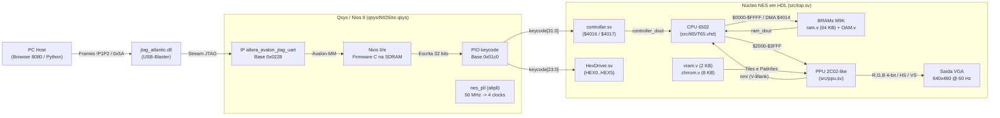
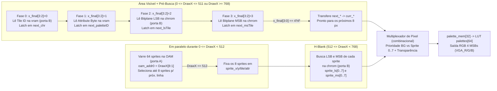

# NES-FPGA — Emulador de NES em HDL (DE10-Lite / Intel MAX 10)

Implementação em hardware de um console **Nintendo Entertainment System (NES)** na placa **Terasic DE10-Lite** (`10M50DAF484C7G`), combinando VHDL/SystemVerilog para o núcleo do console e um softcore **Nios II/e** usado apenas como ponte de entrada entre o PC e os registradores de controle.

---

## Sumário

1. [Visão Geral da Arquitetura](#1-visão-geral-da-arquitetura)
2. [Módulos Principais em `src/`](#2-módulos-principais-em-src)
3. [A Pipeline do Emulador (CPU, DMA, PPU e VGA)](#3-a-pipeline-do-emulador-cpu-dma-ppu-e-vga)
4. [Como o Softcore Nios II é Usado](#4-como-o-softcore-nios-ii-é-usado)
5. [Comunicação PC ↔ FPGA via JTAG UART e `jtag_atlantic.dll`](#5-comunicação-pc--fpga-via-jtag-uart-e-jtag_atlanticdll)
6. [Scripts do Site, Ponte PC e Cartuchos](#6-scripts-do-site-ponte-pc-e-cartuchos)
7. [Limitações Conhecidas no Hardware (Issues)](#7-limitações-conhecidas-no-hardware-issues)
8. [Documentação Complementar](#8-documentação-complementar)

---

## 1. Visão Geral da Arquitetura

O projeto separa **emulação em tempo real** (100% em hardware dedicado) de **interface com periféricos externos** (processada por software em um microcontrolador dentro da FPGA):

- **Núcleo do NES (VHDL + SystemVerilog):** Executa a CPU 6502 (`T65`), a unidade gráfica (`ppu.sv`), o controlador VGA (`VGA_Controller.sv`), a lógica dos controles (`controller.sv`) e as memórias internas BRAM M9K (`ram`, `vram`, `OAM`, `chrrom`).
- **Subsistema Auxiliar Qsys / Nios II/e:** Não participa da execução do jogo nem dos cálculos de vídeo. Ele roda um firmware em C (`main.c`) na SDRAM externa para receber comandos do PC pela interface **JTAG UART** (ou de um teclado USB via shield SPI MAX3421E) e atualizar uma palavra paralela de 32 bits (`keycode`) entregue continuamente ao módulo [`src/controller.sv`](src/controller.sv).

---

## 2. Módulos Principais em `src/`

| Arquivo / Pasta | Linguagem | Papel no Hardware |
| :--- | :--- | :--- |
| [`src/top.sv`](src/top.sv) | SystemVerilog | Top-level do sistema: instancia `NIOSIIe`, `T65`, `ppu`, `controller`, `ram`, `OAM`, `HexDriver` e `sync`, além de implementar o roteamento de barramentos e a FSM de OAM DMA (`$4014`). |
| [`src/t65/`](src/t65/T65.vhd) | VHDL | Núcleo open-source do processador 65xx (`T65.vhd`, `T65_MCode.vhd`, `T65_ALU.vhd`, `T65_Pack.vhd`), configurado em `mode = 2'b0` (6502) e `BCD_en = 1'b0` (o 2A03 do NES não usa modo decimal BCD). |
| [`src/ppu.sv`](src/ppu.sv) | SystemVerilog | Emula os registradores `$2000–$2007`, gerencia memória de padrões (`chrrom`), nametables (`vram`) e paletas, e executa a pipeline de renderização síncrona pixel a pixel em `vga_clk`. |
| [`src/VGA_Controller.sv`](src/VGA_Controller.sv) | SystemVerilog | Gera os contadores de varredura `DrawX` (`0..799`), `DrawY` (`0..524`), pulsos `hs`/`vs` e sinais `h_blank`/`v_blank` no padrão VESA `640x480 @ 60 Hz`. |
| [`src/controller.sv`](src/controller.sv) | SystemVerilog | Emula os dois shift registers seriais CMOS 4021 do NES mapeados em `$4016` (Player 1) e `$4017` (Player 2) a partir dos bits `keycode[15:0]`. |
| [`src/ram/ram.v`](src/ram/ram.v) | Verilog (IP) | BRAM M9K single-port de **64 KB** (`65536 x 8` bits) inicializada com `../cart_init/prg.mif` (`$0000–$7FFF` zerados; `$8000–$FFFF` com a PRG-ROM). |
| [`src/chrrom/chrrom.v`](src/chrrom/chrrom.v) | Verilog (IP) | BRAM M9K dual-port de **8 KB** (`8192 x 8` bits) inicializada com `../cart_init/chr.mif` (tiles/sprites de 2 bitplanes). |
| [`src/vram/vram.v`](src/vram/vram.v) | Verilog (IP) | BRAM M9K dual-port de **2 KB** (`2048 x 8` bits) para nametables e attribute tables da PPU. |
| [`src/OAM/OAM.v`](src/OAM/OAM.v) | Verilog (IP) | BRAM M9K dual-port de **256 bytes** (`256 x 8` bits) armazenando até 64 sprites (4 bytes cada: Y, Tile, Atributo, X). |
| [`src/sync.sv`](src/sync.sv) | SystemVerilog | Flip-flops de sincronização (`sync2`, `sync8`, `sync10`) para trazer `KEY` e `SW` ao domínio de `nes_clk`. |
| [`src/HexDriver.sv`](src/HexDriver.sv) | SystemVerilog | Decodificador combinacional de 4 bits para displays de 7 segmentos (`HEX0..HEX5`, ativo em nível baixo). |

---

## 3. A Pipeline do Emulador (CPU, DMA, PPU e VGA)

O emulador funciona **sem framebuffer em SDRAM**: a imagem é calculada linha a linha em tempo real (*race the beam*) enquanto o controlador VGA varre o monitor.

### 3.1 Domínios de Clock (`nes_pll`)

A partir do oscilador de **50 MHz** da DE10-Lite (`MAX10_CLK1_50`), o bloco `nes_pll` (`altpll` dentro de [`qsys/NIOSIIe.qsys`](qsys/NIOSIIe.qsys)) sintetiza os 4 clocks principais do console:

| Sinal | Razão configurada na PLL | Frequência | Função |
| :--- | :--- | :--- | :--- |
| `nes_clk` | `50 MHz * 2684659 / 6250000` | **~21,477 MHz** | Clock master NTSC: dirige `ram.v`, porta B da `OAM`, acesso da PPU à `vram`/`chrrom` e a FSM de DMA. |
| `cpu_clk` | `50 MHz * 1789773 / 50000000` | **~1,790 MHz** | Clock do 6502 (`nes_clk / 12`), registradores da PPU (`$2000–$2007`) e `controller.sv`. |
| `ppu_clk` | `50 MHz * 21477 / 200000` | **~5,369 MHz** | `3x cpu_clk` (`nes_clk / 4`), gera o disparo do sinal `nmi` da PPU. |
| `vga_clk` | `50 MHz * 1007 / 2000` | **25,175 MHz** | Pixel clock VESA `640x480 @ 60 Hz`: dirige `VGA_Controller` e toda a pipeline de renderização de `ppu.sv`. |

*(Um segundo PLL em `NIOSIIe.qsys` gera o clock da SDRAM em `50 MHz` com defasagem de `-1,00 ns` para compensar atraso de PCB.)*

### 3.2 Pipeline de Acesso da CPU e OAM DMA (`$4014`)

1. **Decodificação combinacional em [`src/top.sv`](src/top.sv):**
   - `$2000–$3FFF`: `databus` seleciona `ppu_dout`.
   - `$4016` ou `$4017`: `databus` seleciona `controller_dout`.
   - Qualquer outro endereço: `databus` seleciona `ram_dout`.
   - Como o núcleo `T65` exige ver o próprio dado no barramento `DI` durante ciclos de escrita, `top.sv` faz `cpu_din = (~cpu_read) ? cpu_dout : databus`.
2. **Transferência de Sprites via OAM DMA (`$4014`):**
   - Quando a CPU escreve no endereço `16'h4014` (ex.: `0x02`), a FSM síncrona em `posedge nes_clk` ativa `dma`, suspende o 6502 (`cpu_enable = ~dma`) e copia 256 bytes da página `{dma_reg, 8'd0}` da `ram` para a porta B da `OAM`.
   - O processo dura `10'h200` (**512 ciclos de `nes_clk`**), alternando pelo bit `dma_count[0]`: nos ciclos pares incrementa o endereço da RAM; nos ímpares escreve na `OAM` e incrementa `dma_oam_addr`.

### 3.3 Pipeline Gráfica *Race-the-Beam* da PPU (`src/ppu.sv`)

O NES gera `256 x 240` pixels, enquanto o monitor VGA usa `640 x 480` ativos (total de `800 x 525` incluindo blanking). Para exibir a imagem sem memória de quadro intermediária, `ppu.sv` faz **upscaling 2x inteiro**:
- Cada pixel do NES ocupa **2 pixels horizontais VGA** (`DrawX[8:1]`) e **2 linhas verticais VGA** (`DrawY[8:1]`).
- A área útil do jogo fica em `0 <= DrawX <= 511` e `0 <= DrawY <= 479` (pixels `512..639` ficam na borda direita em preto).

Esse fator 2x horizontal é a chave da pipeline: cada **tile de 8 pixels do NES** leva **16 clocks de `vga_clk`** (`x_final[3:0]`), divididos em **4 sub-estágios** (`x_final[3:2] == 0..3`) para buscar sequencialmente todos os bytes necessários usando uma única porta B da `vram` e da `chrrom`:

Passo a passo em cada quadro VGA (`DrawY` de `0` a `524`):

1. **Busca contínua do próximo tile de Background (`x_final = DrawX + {scroll_x, 1'b0}`):**
   Enquanto os registradores `curr_*` desenham o tile atual nos pinos VGA, os registradores `next_*` já buscam na porta B da `vram` e da `chrrom` os dados do tile seguinte:
   - `x_final[3:2] == 2'h0`: endereço na `vram` aponta para a *Nametable* (`chr`).
   - `2'h1`: endereço na `vram` aponta para a *Attribute Table* (seleciona a sub-paleta de 2 bits para aquele bloco 16x16).
   - `2'h2`: endereço na `chrrom` aponta para o bitplane 0 (LSB) do padrão do tile.
   - `2'h3`: endereço na `chrrom` aponta para o bitplane 1 (MSB) do padrão do tile.
   - Em `x_final[3:0] == 4'hF`, o conjunto `next_*` é promovido para `curr_*`.
2. **Avaliação de Sprites (durante a linha ativa `0 <= DrawX < 512`):**
   A porta A da `OAM` é lida continuamente usando `oam_addr0 = DrawX[8:1]` (256 ciclos por linha = exatamente os 64 sprites x 4 bytes). Sprites cuja coordenada `Y` intercepta a próxima linha a ser desenhada são copiados para os buffers internos `sprite_*_next` (limite de 8 sprites por linha; acima disso ativa a flag `PPUSTATUS[5]` de *sprite overflow*).
3. **Busca dos Bitplanes dos Sprites no H-Blank (`512 <= DrawX < 768`):**
   Quando o feixe VGA entra no recuo horizontal (`h_blank = 1`), a `chrrom` porta B deixa de atender o background e passa a buscar o `sprite_ls[0..7]` e `sprite_ms[0..7]` dos até 8 sprites selecionados. A partir de `DrawX >= 768`, o sistema volta ao background para pré-carregar o primeiro tile da linha seguinte (`nextline`).
4. **Prioridade de Pixel e Paleta DAC:**
   Um multiplexador combinacional cruza o índice de 2 bits do background (`curr_lsTile`/`curr_msTile`) com os índices dos 8 sprites ativos na coordenada `DrawX[8:1]`: cor `2'b00` é transparente; o bit 5 do atributo do sprite decide se ele aparece na frente ou atrás do background. O índice final (`0..31`) consulta `palette_mem[32]` para obter o código NES (`0..63`), convertido pela tabela `palettes[64]` (RGB de 24 bits) com os 4 bits mais significativos de cada canal indo ao DAC resistor-ladder da DE10-Lite.
5. **V-Blank e NMI:**
   Quando `DrawY == 480`, `PPUSTATUS[7]` é setado (início do V-Blank); em `DrawY[8:1] == 240`, se `PPUCTRL[7]` estiver habilitado, a PPU pulsa `nmi` (`cpu_nmi = ~ppu_nmi` no `top.sv`), avisando a CPU 6502 de que ela pode atualizar a `vram` e disparar o OAM DMA (`$4014`) sem rasgar a tela.

---

## 4. Como o Softcore Nios II é Usado

O sistema Qsys ([`qsys/NIOSIIe.qsys`](qsys/NIOSIIe.qsys)) instancia um processador RISC **Nios II Economy (`/e`)** a `50 MHz` conectado via barramento **Avalon Memory-Mapped (Avalon-MM)** aos seguintes periféricos principais:

- `sdram` (`0x08000000`): Controlador da SDRAM externa de **64 MB** da DE10-Lite, onde residem o código e os vetores de reset/exceção do Nios II.
- `jtag_uart_0` (`0x0228`, IRQ `16`, FIFOs RX/TX de 64 bytes): Canal serial encapsulado no JTAG que conversa com o PC pelo cabo USB-Blaster.
- `keycode` (`0x01c0`, PIO de saída de 32 bits): Porta paralela ligada diretamente ao `top.sv` (`keycode_export`).
- `spi0` e PIOs `usb_rst`, `usb_irq`, `usb_gpx`: Interface SPI opcional para teclado USB físico via shield Arduino MAX3421E.

### Fluxo do Firmware ([`qsys/software/usb_controller/main.c`](qsys/software/usb_controller/main.c))

1. **Carga na SDRAM:** Como o `.sof` configura apenas a lógica da FPGA (não o programa da SDRAM externa), toda vez que a placa é ligada ou regravada, o arquivo `usb_controller.elf` precisa ser baixado para a SDRAM via JTAG (`nios2-download -g`).
2. **Polling sem Interrupções:** Na inicialização, `main.c` desregistra o handler de IRQ da JTAG UART (`alt_irq_register(JTAG_UART_0_IRQ, NULL, NULL)`) mantendo o bit `RE = 1` no registrador `CONTROL` da UART e envia `"RDY\n"`. No `while(1)`, `poll_jtag_uart()` lê diretamente o registrador `DATA` (`0x0228`) sem bloqueio para evitar latência de driver HAL.
3. **Empacotamento dos 32 bits de `keycode`:**

| Fatia em `keycode[31:0]` | Conteúdo | Uso no Hardware (`src/top.sv` e `src/controller.sv`) |
| :--- | :--- | :--- |
| `[7:0]` | `g_usb_p1_mask \| g_pc_p1_mask` | Botões do Player 1 (exibidos em `HEX1–HEX0`). |
| `[15:8]` | `g_pc_p2_mask` | Botões do Player 2 (exibidos em `HEX3–HEX2`). |
| `[23:16]` | `g_rx_packet_cnt` (8 LSBs) | Contador de pacotes válidos recebidos. Com `SW[0] = 1`, aparece em `HEX5–HEX4`; com `SW[0] = 0`, `HEX5–HEX4` mostram `"dE"`. |
| `[31:24]` | `8'h00` | Mantido em zero para selecionar o modo Dual Mask nos displays `HEX` (qualquer valor diferente entra no modo legado USB HID). |

---

## 5. Comunicação PC ↔ FPGA via JTAG UART e `jtag_atlantic.dll`

Em vez de adicionar um adaptador USB-Serial externo, o PC se comunica pelo próprio cabo **USB-Blaster** usando o protocolo **JTAG Atlantic** da Intel sobre o **SLD JTAG Hub** dentro da FPGA.

```mermaid
flowchart LR
    WEB["Browser (app.js)\nWebSocket 60 FPS"] -->|"JSON mask2"| NODE["nes_controller.js\n(Node.js :8080)"]
    NODE -->|"stdin: !P1P2 (ASCII)"| PY["jtag_bridge.py\n(Python ctypes)"]
    PY -->|"jtagatlantic_write()"| DLL["jtag_atlantic.dll\n(Quartus bin64)"]
    DLL -->|"USB-Blaster"| SLD["SLD JTAG Hub\n(Silício MAX 10)"]
    SLD -->|"Avalon-MM 0x0228"| NIOS["Nios II (main.c)\npoll_jtag_uart()"]
    NIOS -->|"PIO 0x01c0"| CTRL["controller.sv\n($4016 / $4017)"]
```

### Como a DLL é acessada no Windows (`pc_controller/jtag_bridge.py`)

O Quartus instala a biblioteca `jtag_atlantic.dll` em `quartus/bin64/`. Como essa DLL exporta símbolos C++ decorados (*MSVC name mangling*), [`pc_controller/jtag_bridge.py`](pc_controller/jtag_bridge.py) a carrega diretamente com `ctypes.CDLL` e mapeia os 7 ponteiros de função exatos (sem abrir processos pesados nem depender do `nios2-terminal.exe`, embora exista fallback para ele se necessário):

- `?jtagatlantic_open@@YAPEAUJTAGATLANTIC@@PEBDHH0@Z` — abre sessão no cabo (ex.: `"USB-Blaster [USB-0]"`).
- `?jtagatlantic_wait_open@@YAHPEAUJTAGATLANTIC@@@Z` — conclui handshake com o IP `jtag_uart_0`.
- `?jtagatlantic_write@@YAHPEAUJTAGATLANTIC@@PEBDI@Z` — grava o frame na FIFO RX da JTAG UART.
- `?jtagatlantic_read@@YAHPEAUJTAGATLANTIC@@PEADI@Z` — lê confirmações (`"OK\n"`, `"RDY\n"`) enviadas pelo Nios II.
- `?jtagatlantic_flush@@YAHPEAUJTAGATLANTIC@@@Z`, `?jtagatlantic_close@@YAXPEAUJTAGATLANTIC@@@Z` e `?jtagatlantic_get_error@@YA?AW4JATL_ERROR@@PEAPEBD@Z`.

### Protocolo de Pacotes

`main.c` aceita três formatos no mesmo stream da JTAG UART:
1. **ASCII HEX (`!<P1_HEX><P2_HEX>\n`)** — padrão usado pelo [`pc_controller/nes_controller.js`](pc_controller/nes_controller.js) (ex.: `!8001\n`). Evita qualquer filtragem de bytes de controle (`0x00..0x1F`) em terminais no Windows.
2. **Binário compacto (`[0x5A, P1_BYTE, P2_BYTE]`)** — usado pelo [`pc_controller/nes_controller.py`](pc_controller/nes_controller.py) quando conectado direto pela `jtag_atlantic.dll` ou pela porta Serial RS-232/DB9 opcional.
3. **Teclas ASCII simples (`W/A/S/D/K/L/G/H`)** — alternam bits do P1 manualmente caso você abra o `nios2-terminal` direto.

> [!IMPORTANT]
> O JTAG Atlantic permite **apenas um cliente por vez** no cabo USB-Blaster (se outro processo já estiver conectado, a DLL retorna erro `-6`). Por isso, antes de gravar um `.sof` ou `.elf`, o servidor Web pausa a ponte JTAG automaticamente e a reconecta ao terminar.

Detalhes completos dos scripts Web, WebSocket RFC 6455, endpoints REST e fallback Serial estão em [`pc_controller/README.md`](pc_controller/README.md).

---

## 6. Scripts do Site, Ponte PC e Cartuchos

- **Interface Web e Servidor (`pc_controller/`):**
  - [`pc_controller/nes_controller.js`](pc_controller/nes_controller.js): servidor HTTP + WebSocket na porta `8080` sem dependências externas (`npm install` não é necessário). Gerencia o ciclo de vida do `jtag_bridge.py`, auto-download do `.elf` na SDRAM e APIs de troca de jogo.
  - [`pc_controller/web/app.js`](pc_controller/web/app.js): cliente no navegador que lê teclado, mouse/touch e até 2 gamepads USB/Bluetooth via HTML5 Gamepad API a 60 FPS e envia `{type: 'mask2', p1, p2}` por WebSocket.
  - [`pc_controller/nes_controller.py`](pc_controller/nes_controller.py) e [`pc_controller/test_jtag_uart.py`](pc_controller/test_jtag_uart.py): cliente console Windows de baixa latência (`GetAsyncKeyState`) e utilitário de diagnóstico em 5 passos da `jtag_atlantic.dll`.
- **Conversor e Gerenciador de Cartuchos (`cart_init/`):**
  - [`cart_init/nes_to_mif.js`](cart_init/nes_to_mif.js): analisa cabeçalho iNES (`.nes`), valida **Mapper 0 (NROM)** e gera `prg.mif` (64 KB, espelhando 16 KB se `prgBanks == 1`) e `chr.mif` (8 KB).
  - [`cart_init/switch_game.js`](cart_init/switch_game.js) e [`cart_init/quartus_cli.js`](cart_init/quartus_cli.js): alternam entre os jogos já convertidos em `cart_init/games/`, rodam atualização incremental de memória (`quartus_cdb --update_mif` + `quartus_asm`) e gravam na DE10-Lite sem resíntese completa.
- **Atalhos na Raiz:** [`compile_project.bat`](compile_project.bat), [`run_web_controller.bat`](run_web_controller.bat), [`run_python_controller.bat`](run_python_controller.bat) e [`test_jtag_uart.bat`](test_jtag_uart.bat).

---

## 7. Limitações Conhecidas no Hardware (Issues)

Estas limitações refletem diretamente escolhas e simplificações presentes no código atual em `src/`:

1. **Apenas Mapper 0 (NROM — até 32 KB PRG + 8 KB CHR):** Não há hardware de *bank switching* (MMC1, MMC3, UxROM, etc.). Jogos compatíveis estão catalogados em [`COMPATIBLE_GAMES.md`](COMPATIBLE_GAMES.md).
2. **RAM unificada de 64 KB em [`src/ram/ram.v`](src/ram/ram.v):** Embora o comentário em `src/top.sv` cite 2 KB de Work RAM (`$0000–$07FF` espelhado até `$1FFF`), a instanciação real usa uma única BRAM de 64 KB inicializada por `prg.mif` com `ram_wren = ~cpu_read` aberto em todo o espaço fora de `$2000–$3FFF` e `$4016–$4017` — ou seja, jogos que escrevam acidentalmente acima de `$8000` (típico de mappers com registradores de banco) sobrescrevem a própria PRG-ROM na BRAM.
3. **Sprite 0 Hit fixado para *Super Mario Bros.*:** Em `src/ppu.sv`, a detecção de colisão do Sprite 0 (`PPUSTATUS[6]`) está hardcoded para acionar em `DrawX[8:1] == 88 && DrawY[8:1] == 30`, em vez de calcular a interseção real de pixels não-transparentes entre background e Sprite 0. Jogos que dependem de Sprite 0 Hit em outra coordenada para split-screen podem travar ou piscar o HUD.
4. **Sem scroll vertical completo:** A PPU implementa scroll horizontal via `scroll_x` (`PPUSCROLL` primeira escrita), mas não aplica offset completo de *scroll vertical* entre nametables durante a varredura.
5. **Sem Unidade de Áudio (APU):** Os registradores `$4000–$4013` e `$4015` não são implementados e a placa DE10-Lite não possui saída de áudio nativa usada pelo projeto.

---

## 8. Documentação Complementar

- [**`COMPILACAO_DO_ZERO.md`**](COMPILACAO_DO_ZERO.md): Instalação das ferramentas (Quartus 18.1, driver USB-Blaster, Node/Python) e compilação passo a passo via script, GUI e terminal.
- [**`BUILD_GUIDE.md`**](BUILD_GUIDE.md): Adição de novas ROMs, troca rápida de jogos sem resíntese, uso dos displays `HEX` / `SW[0]` / `KEY[0]` e troubleshooting.
- [**`pc_controller/README.md`**](pc_controller/README.md): Funcionamento detalhado do site, WebSocket, endpoints REST, acesso à `jtag_atlantic.dll`, protocolo JTAG UART e porta Serial DB9.
- [**`COMPATIBLE_GAMES.md`**](COMPATIBLE_GAMES.md): Catálogo dos jogos NROM compatíveis já estruturados em `cart_init/games/`.
