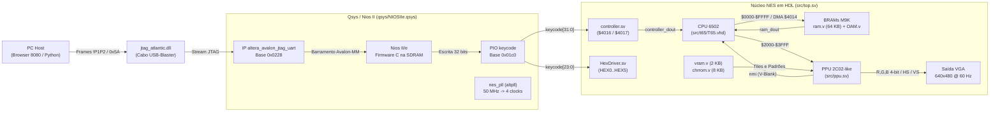
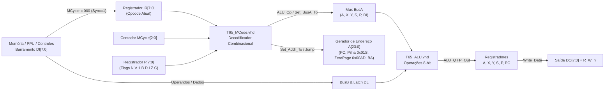
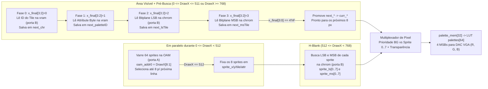

# NES-FPGA — Emulador de NES em HDL (DE10-Lite / Intel MAX 10)

Implementação em hardware de um console **Nintendo Entertainment System (NES)** na placa **Terasic DE10-Lite** (chip FPGA **Intel MAX 10 `10M50DAF484C7G`**), escrita em **HDL** (*Hardware Description Language* — linguagens de descrição de hardware **VHDL**, **SystemVerilog** e **Verilog**).

O projeto combina lógica digital pura para emular o console original com um processador auxiliar **softcore** (*processador implementado com células lógicas da própria FPGA*) **Nios II/e**, usado exclusivamente como ponte entre o computador (PC) e os controles do jogo.

---

## Sumário

1. [Visão Geral da Arquitetura](#1-visão-geral-da-arquitetura)
2. [Módulos Principais em `src/`](#2-módulos-principais-em-src)
3. [O Processador do Emulador: CPU 6502 (`T65` em VHDL)](#3-o-processador-do-emulador-cpu-6502-t65-em-vhdl)
4. [A Pipeline do Emulador (Clocks, DMA, PPU e VGA)](#4-a-pipeline-do-emulador-clocks-dma-ppu-e-vga)
5. [Como o Softcore Nios II é Usado](#5-como-o-softcore-nios-ii-é-usado)
6. [Comunicação PC ↔ FPGA via JTAG UART e `jtag_atlantic.dll`](#6-comunicação-pc--fpga-via-jtag-uart-e-jtag_atlanticdll)
7. [Scripts do Site, Ponte PC e Cartuchos](#7-scripts-do-site-ponte-pc-e-cartuchos)
8. [Limitações Conhecidas no Hardware (Issues)](#8-limitações-conhecidas-no-hardware-issues)
9. [Documentação Complementar](#9-documentação-complementar)

---

## 1. Visão Geral da Arquitetura

O projeto separa **emulação em tempo real** (hardware dedicado que replica os chips do console) de **comunicação com o usuário** (um pequeno processador programado em C apenas para receber teclas do PC):

- **Núcleo do NES em HDL:** Executa a **CPU** 6502 (`T65`, em VHDL), a **PPU** (*Picture Processing Unit*, a placa de vídeo integrada do NES, em `ppu.sv`), o gerador de vídeo **VGA** (*Video Graphics Array*, em `VGA_Controller.sv`), o circuito dos controles (`controller.sv`) e as memórias **BRAM M9K** (*Block RAM* de 9 kilobits embutida no silício da FPGA: `ram`, `vram`, `OAM`, `chrrom`).
- **Subsistema Auxiliar Qsys / Nios II/e:** Não roda o jogo nem calcula gráficos. Ele executa um programa simples em C (`main.c`) na memória externa **SDRAM** (*Synchronous Dynamic RAM*) para ler os comandos enviados pelo PC via **JTAG UART** (canal serial que usa o mesmo cabo USB de gravação da placa) e gravar os botões pressionados em um registrador paralelo de 32 bits chamado `keycode`, lido continuamente pelo módulo [`src/controller.sv`](src/controller.sv).

---

## 2. Módulos Principais em `src/`

Antes de olhar a tabela, vale entender as quatro siglas das memórias do NES:
- **PRG-ROM** (*Program ROM*): memória onde fica gravado o código de máquina (programa) do jogo.
- **CHR-ROM** (*Character ROM*): memória com os desenhos brutos de blocos gráficos (`tiles` de 8×8 pixels, tanto do cenário quanto dos personagens).
- **VRAM** (*Video RAM*): memória de vídeo onde a CPU escreve qual desenho vai em cada posição da tela (*nametable*) e qual paleta de cores cada bloco usa (*attribute table*).
- **OAM** (*Object Attribute Memory*): tabela pequena (256 bytes) dedicada aos **sprites** (objetos móveis independentes do cenário, como o Mario, inimigos e moedas).

| Arquivo / Pasta | Linguagem | Papel no Hardware |
| :--- | :--- | :--- |
| [`src/top.sv`](src/top.sv) | SystemVerilog | Módulo principal (*top-level*): conecta `NIOSIIe`, CPU `T65`, `ppu`, `controller`, memórias BRAM, `HexDriver` e `sync`; implementa a decodificação de endereços e a FSM de cópia automática de sprites (**OAM DMA** em `$4014`). |
| [`src/t65/`](src/t65/T65.vhd) | VHDL | Núcleo open-source do processador 6502 (`T65.vhd`, `T65_MCode.vhd`, `T65_ALU.vhd`, `T65_Pack.vhd`), configurado para replicar a CPU Ricoh 2A03 do NES. |
| [`src/ppu.sv`](src/ppu.sv) | SystemVerilog | Emula os registradores de vídeo `$2000–$2007`, lê `chrrom` e `vram`, seleciona cores de paleta e calcula cada pixel em tempo real na frequência do monitor VGA. |
| [`src/VGA_Controller.sv`](src/VGA_Controller.sv) | SystemVerilog | Contadores de varredura horizontal `DrawX` (`0..799`) e vertical `DrawY` (`0..524`), além dos pulsos `hs` (*Horizontal Sync*) e `vs` (*Vertical Sync*) no padrão **VESA** `640x480 @ 60 Hz`. |
| [`src/controller.sv`](src/controller.sv) | SystemVerilog | Emula os dois **shift registers** (registradores de deslocamento serial **CMOS 4021**) dos controles originais do NES em `$4016` (Player 1) e `$4017` (Player 2). |
| [`src/ram/ram.v`](src/ram/ram.v) | Verilog (IP) | Memória **BRAM M9K** single-port de **64 KB** (`65536 x 8` bits) inicializada pelo arquivo `../cart_init/prg.mif` (`$0000–$7FFF` zerados; `$8000–$FFFF` com a **PRG-ROM**). |
| [`src/chrrom/chrrom.v`](src/chrrom/chrrom.v) | Verilog (IP) | Memória **BRAM M9K** dual-port de **8 KB** (`8192 x 8` bits) inicializada com `../cart_init/chr.mif` (armazena os desenhos da **CHR-ROM**). |
| [`src/vram/vram.v`](src/vram/vram.v) | Verilog (IP) | Memória **BRAM M9K** dual-port de **2 KB** (`2048 x 8` bits) para os mapas de tela (**VRAM**). |
| [`src/OAM/OAM.v`](src/OAM/OAM.v) | Verilog (IP) | Memória **BRAM M9K** dual-port de **256 bytes** (`256 x 8` bits) para os 64 sprites simultâneos (**OAM**, 4 bytes por sprite: posição Y, índice do tile, atributos e posição X). |
| [`src/sync.sv`](src/sync.sv) | SystemVerilog | Registradores sincronizadores (`sync2`, `sync8`, `sync10`) que evitam metaestabilidade ao trazer chaves `SW` e botões `KEY` da placa para o domínio de clock `nes_clk`. |
| [`src/HexDriver.sv`](src/HexDriver.sv) | SystemVerilog | Decodificador combinacional de 4 bits para os 6 displays de 7 segmentos da placa (`HEX0..HEX5`, ativos em nível lógico baixo `'0'`). |

---

## 3. O Processador do Emulador: CPU 6502 (`T65` em VHDL)

O "cérebro" do NES é uma versão customizada do microprocessador **MOS 6502** chamada **Ricoh 2A03** (arquitetura de 8 bits para dados e 16 bits para endereços, capaz de endereçar 64 KB: `$0000` até `$FFFF`). Neste projeto, ele é implementado inteiramente em VHDL pelo núcleo **`T65`** em [`src/t65/`](src/t65/T65.vhd).

### 3.1 Arquitetura Multiciclo com Microcódigo (sem Pipeline Clássico RISC)

Diferente de processadores modernos tipo MIPS/RISC-V que buscam 1 instrução por clock em pipeline de 5 estágios, o 6502 (e o `T65`) é uma **CPU CISC multiciclo controlada por microcódigo**:
- Cada instrução leva entre **2 e 7 ciclos de clock** (`cpu_clk` ≈ 1,79 MHz) para completar, realizando **1 acesso à memória por ciclo**.
- O núcleo é dividido em três blocos VHDL em `src/t65/`:
  1. **[`T65.vhd`](src/t65/T65.vhd) (Datapath e FSM de Ciclos):** Contém os registradores, multiplexadores de barramento, lógica de reset/interrupção e o contador de ciclos de máquina `MCycle` (`"000"` a `"111"`).
  2. **[`T65_MCode.vhd`](src/t65/T65_MCode.vhd) (Unidade de Controle / Microcódigo):** Um grande decodificador combinacional que observa o *opcode* atual (`IR`), o ciclo em andamento (`MCycle`), as flags (`P`) e gera os sinais de controle para o próximo ciclo: qual operação a **ALU** (*Arithmetic Logic Unit* — Unidade Lógica e Aritmética) deve fazer (`ALU_Op`), de onde vem o endereço (`Set_Addr_To`), quem dirige a ALU (`Set_BusA_To`), se o ciclo é de escrita (`Write`) e qual o último ciclo da instrução (`LCycle`).
  3. **[`T65_ALU.vhd`](src/t65/T65_ALU.vhd) (Unidade Lógica e Aritmética):** Executa somas (`ADC`), subtrações (`SBC`), lógica booleana (`AND`, `OR`, `EOR`), rotações/deslocamentos (`ASL`, `LSR`, `ROL`, `ROR`), comparações e recalcula os bits de resultado (`P_Out`).

### 3.2 Registradores Internos e Configuração para o NES

No `src/top.sv`, o `T65` é instanciado com dois parâmetros fixos que o transformam no chip Ricoh 2A03 do NES:
- `.mode (2'b0)`: seleciona o conjunto de instruções do **6502 clássico** (o `T65` também suporta variantes posteriores como 65C02 e 65C816, desligadas aqui).
- `.BCD_en (1'b0)`: desativa o modo **BCD** (*Binary-Coded Decimal*, aritmética decimal codificada em binário). No 6502 original, se a flag `D` estivesse ligada, uma soma como `0x09 + 0x01` virava `0x10` (ajuste +6 por dígito na `T65_ALU.vhd`); a Nintendo removeu esse circuito no NES por questões de patente, e `BCD_en = '0'` reproduz exatamente esse comportamento.

Os registradores acessíveis ao código do jogo são:
- **`PC` (16 bits — *Program Counter*):** Aponta para o endereço da próxima instrução ou operando na memória.
- **`A` / `ABC` (8 bits efetivos — Acumulador):** Principal registrador usado para cálculos aritméticos, lógicos e transferências com a memória.
- **`X` e `Y` (8 bits efetivos cada):** Registradores auxiliares usados para indexar vetores em memória e contar iterações de laços (*loops*).
- **`S` (8 bits efetivos — *Stack Pointer*):** Aponta para o topo da pilha de chamadas e variáveis temporárias, fixada pela hardware no endereço `0x0100` até `0x01FF` (`"0000000000000001" & S(7:0)` quando `Set_Addr_To_SP`).
- **`P` (8 bits — Registrador de Status / *Flags*, definidos em [`T65_Pack.vhd`](src/t65/T65_Pack.vhd)):**

| Bit | Sigla | Nome e Função |
| :---: | :---: | :--- |
| `7` | **N** (`Flag_N`) | *Negative*: vale `1` se o bit mais significativo (bit 7) do resultado foi `1` (negativo em complemento de 2). |
| `6` | **V** (`Flag_V`) | *Overflow*: indica estouro de sinal aritmético em somas/subtrações com sinal. |
| `5` | **1** (`Flag_1`) | Bit reservado, sempre mantido em `1`. |
| `4` | **B** (`Flag_B`) | *Break*: diferencia uma instrução `BRK` em software de uma interrupção externa `IRQ`/`NMI` quando `P` é salvo na pilha (`PwithB`). |
| `3` | **D** (`Flag_D`) | *Decimal*: pode ser ligada/desligada (`SED`/`CLD`), mas não altera somas/subtrações porque `BCD_en = '0'`. |
| `2` | **I** (`Flag_I`) | *Interrupt Disable*: quando `1`, bloqueia pedidos de interrupção mascarável `IRQ_n`. |
| `1` | **Z** (`Flag_Z`) | *Zero*: vale `1` quando o resultado da operação foi exatamente `0x00`. |
| `0` | **C** (`Flag_C`) | *Carry*: vai-um aritmético, bit emprestado na subtração ou bit deslocado em instruções de *shift*/rotação. |

Além desses, o `T65` usa registradores internos invisíveis ao programador para executar instruções em múltiplos passos: `IR` (guarda o *opcode*), `DL` (*Data Latch*, retém temporariamente bytes lidos da memória ou resultados da ALU), `AD` (endereçamento de *Zero Page*, `$0000–$00FF`) e `BAH`/`BAL` (*Base Address High/Low*, montam endereços de 16 bits indiretos ou indexados).

### 3.3 Ciclo de Instrução e Vetores de Interrupção (`RESET`, `NMI`, `IRQ`)

1. **Busca (*Fetch* em `MCycle = "000"`):** O sinal `Sync` vai a `'1'`. O endereço sai de `PC`, o byte lido em `DI` é salvo no registrador de instrução `IR`, e `PC` incrementa em `+1`.
2. **Execução (`MCycle = "001"` até `LCycle`):** O `T65_MCode` guia os ciclos restantes para buscar operandos, somar deslocamentos com `X`/`Y`, ler/escrever dados (`R_W_n = '1'` leitura, `'0'` escrita) e atualizar `A`, `X`, `Y`, `S` ou `P`. Quando `MCycle = LCycle` (ou `Break = '1'` em desvios curtos), retorna a `"000"`.
3. **Tratamento de Reset e Interrupções (reaproveitando `IR = 0x00`):**
   Quando ocorre Reset ou interrupção ao fim de uma instrução, o `T65` força `IR <= 0x00` para reutilizar a rotina de microcódigo de empilhamento e ler um **vetor de 16 bits** (dois bytes fixos no fim da ROM, `BAL`/`BAH` apontando para `$FFFx`):
   - **RESET (`$FFFC–$FFFD`, `BAL(2:0) = "100"`):** Acionado quando `KEY[0]` é pressionado (nível `'0'` sincronizado por `sync2`). Após soltar o botão, lê `$FFFC/$FFFD` para descobrir em qual endereço o jogo começa.
   - **NMI (*Non-Maskable Interrupt* — `$FFFA–$FFFB`, `BAL(2:0) = "010"`):** Interrupção que **não pode ser ignorada** pela flag `I`. É ligada à PPU (`cpu_nmi = ~ppu_nmi`): toda vez que o monitor termina de desenhar um quadro (60 vezes por segundo), a PPU puxa `NMI_n` para `'0'`; o `T65` detecta a borda de descida em `NMIAct`, salva `PC` e `P` na pilha e salta para o código de atualização de tela do jogo.
   - **IRQ (*Interrupt Request* — `$FFFE–$FFFF`, `BAL(2:0) = "110"`):** Interrupção mascarável (ignorada se `Flag_I = 1`). No `top.sv`, `cpu_irq` é mantido em `1'b1` (desativado).

### 3.4 Detalhes Críticos de Integração no Hardware (`src/top.sv`)

- **Pausa sem *Clock Gating* (`Enable = ~dma`):** Em FPGA, nunca se deve desligar o pino de clock de um módulo usando uma porta `AND` (*clock gating*), pois isso gera *skew* e falhas de temporização. O `T65` resolve isso com a entrada síncrona `Enable`: enquanto o controlador de **DMA** copia sprites, `top.sv` coloca `cpu_enable = 0`, mantendo `cpu_clk` oscilando normalmente mas congelando todos os flip-flops da CPU sem perder seu estado.
- **Loopback obrigatório em escrita (`cpu_din = cpu_dout`):** Como alertado nos comentários do próprio [`T65.vhd`](src/t65/T65.vhd#L113-L125), sempre que `R_W_n = '0'` (ciclo de escrita), o `top.sv` devolve `cpu_dout` de volta para `cpu_din`, garantindo que opcodes que fazem leitura-modificação-escrita ou instruções não-documentadas do 6502 operem corretamente.

---

## 4. A Pipeline do Emulador (Clocks, DMA, PPU e VGA)

O emulador funciona **sem framebuffer em SDRAM**: em vez de desenhar o quadro inteiro em uma memória externa para só depois enviá-lo ao monitor, a **PPU** calcula **pixel a pixel em tempo real** acompanhando o feixe de varredura do monitor VGA (técnica conhecida como *race the beam*).

### 4.1 Domínios de Clock (`nes_pll`) e o que é "Clock Master NTSC"

Os televisores do padrão **NTSC** (*National Television System Committee*, usado nas Américas e no Brasil para sistemas analógicos de 60 Hz) derivam a frequência de subportadora de cor de ~3,58 MHz. No NES original, o cristal oscilador principal (**Clock Master NTSC**) roda a exatos **6 × 3,579545 MHz ≈ 21,477 MHz**, e dele são divididos os clocks internos do console.

Na DE10-Lite, o único oscilador disponível para o projeto é de **50 MHz** (`MAX10_CLK1_50`). O bloco **`nes_pll`** — uma **PLL** (*Phase-Locked Loop*, circuito analógico/digital interno da FPGA que multiplica e divide frequências mantendo a fase estável) configurado em [`qsys/NIOSIIe.qsys`](qsys/NIOSIIe.qsys) — sintetiza os 4 clocks do sistema:

| Sinal | Razão configurada na PLL | Frequência | Função |
| :--- | :--- | :--- | :--- |
| `nes_clk` | `50 MHz * 2684659 / 6250000` | **~21,477 MHz** | Clock master NTSC: dirige `ram.v`, porta B da `OAM`, leitura/escrita da CPU na `vram`/`chrrom` e a FSM de DMA. |
| `cpu_clk` | `50 MHz * 1789773 / 50000000` | **~1,790 MHz** | Clock da CPU 6502 (`nes_clk / 12`), registradores `$2000–$2007` da PPU e `controller.sv`. |
| `ppu_clk` | `50 MHz * 21477 / 200000` | **~5,369 MHz** | `3 × cpu_clk` (`nes_clk / 4`), sincroniza o disparo da interrupção `nmi` da PPU. |
| `vga_clk` | `50 MHz * 1007 / 2000` | **25,175 MHz** | Pixel clock padrão VESA `640x480 @ 60 Hz`: dirige o `VGA_Controller` e toda a pipeline gráfica de `ppu.sv`. |

*(Uma segunda PLL no `NIOSIIe.qsys` gera o clock `sdram_clk` em `50 MHz` com atraso de fase de `-1,00 ns` para compensar o tempo de propagação nas trilhas da placa até o chip SDRAM.)*

### 4.2 Decodificação de Barramento e OAM DMA (`$4014`)

Em [`src/top.sv`](src/top.sv), a CPU enxerga todo o console através de um único barramento de endereços de 16 bits (`cpu_addr[15:0]`):
- **`$2000–$3FFF`:** roteia para os registradores da PPU (`ppu_dout`).
- **`$4016` e `$4017`:** roteia para os registradores dos controles P1 e P2 (`controller_dout`).
- **Demais endereços:** roteia para a memória unificada de 64 KB (`ram_dout`).

**Como funciona o OAM DMA (`$4014`):**
**DMA** (*Direct Memory Access*, Acesso Direto à Memória) é um circuito que transfere blocos de bytes automaticamente sem que a CPU precise executar centenas de instruções `LDA` + `STA`. No NES, um jogo atualiza a posição de todos os 64 personagens/inimigos de uma só vez escrevendo o número da página de RAM (ex.: `0x02`, representando `$0200–$02FF`) no registrador `$4014`:
1. Ao detectar `cpu_addr == 16'h4014` em `posedge nes_clk`, a máquina de estados em `top.sv` ativa `dma <= 1` e congela a CPU (`cpu_enable = ~dma`).
2. Durante `10'h200` (**512 ciclos de `nes_clk`**), ela alterna a cada ciclo usando `dma_count[0]`:
   - Ciclos pares: lê um byte da página `{dma_reg, 8'd0}` na `ram.v` e incrementa o endereço da RAM.
   - Ciclos ímpares: grava esse byte na porta B da memória **OAM** (`OAM.v`) e incrementa `dma_oam_addr` (ao fim de 256 bytes, todos os 64 sprites estão atualizados).

### 4.3 Pipeline Gráfica *Race-the-Beam* da PPU (`src/ppu.sv`)

Antes de seguir o fluxo, vale diferenciar os dois planos visuais e os intervalos da tela:
- **Background (cenário de fundo):** Grade fixa de `32 x 30` **tiles** (blocos de 8×8 pixels), totalizando `256 x 240` pixels. A **Nametable** na `vram` guarda qual número de tile vai em cada célula; a **Attribute Table** guarda os 2 bits que escolhem a sub-paleta de cores de cada bloco 16×16.
- **Bitplanes (LSB e MSB):** Na `chrrom`, cada tile de 8×8 pixels ocupa 16 bytes — 8 bytes formam o plano de bit menos significativo (**LSB**) e 8 bytes formam o plano mais significativo (**MSB**). Combinando o bit correspondente dos dois planos, cada pixel obtém um índice de 2 bits (`00` a `11`, ou 4 possibilidades de cor).
- **H-Blank (*Horizontal Blanking*) e V-Blank (*Vertical Blanking*):** O monitor VGA conta `0..799` na horizontal e `0..524` na vertical, mas só exibe imagem dentro de `640 x 480`. Os períodos fora da área visível são os recuos (*blanking*), onde o feixe retorna à esquerda (**H-Blank**) ou ao topo da tela (**V-Blank**) sem desenhar nada.

Como o NES gera `256 x 240` pixels e o monitor VGA exibe `640 x 480`, `ppu.sv` aplica um **upscaling 2× inteiro**:
- Cada pixel do NES dura **2 clocks VGA na horizontal** (`DrawX[8:1]`) e **2 linhas VGA na vertical** (`DrawY[8:1]`).
- A área útil do jogo ocupa `0 <= DrawX <= 511` e `0 <= DrawY <= 479` (as colunas `512..639` da direita permanecem pretas).

Essa multiplicação por 2 na horizontal é o truque que viabiliza a pipeline sem memória extra: **1 tile de 8 pixels do NES dura exatamente 16 clocks de `vga_clk`** (`x_final[3:0]`). A PPU divide esses 16 clocks em **4 sub-fases** (`x_final[3:2]` de `0` a `3`) para buscar o próximo tile na `vram` e na `chrrom` enquanto os registradores `curr_*` continuam desenhando o tile atual:

Etapas executadas a cada quadro (`DrawY` de `0` a `524`):

1. **Pré-busca contínua do Background (`x_final = DrawX + {scroll_x, 1'b0}`):**
   Enquanto o tile atual (`curr_*`) está saindo nos pinos VGA, a porta B da `vram` e da `chrrom` busca sequencialmente o próximo tile em `next_chr`, `next_paletteID`, `next_lsTile` e `next_msTile`. No último clock do tile (`x_final[3:0] == 4'hF`), `next_*` vira `curr_*`.
2. **Avaliação de Sprites na linha ativa (`0 <= DrawX < 512`):**
   Ao mesmo tempo, a porta A da `OAM` é varrida com `oam_addr0 = DrawX[8:1]` (256 acessos por linha = todos os 64 sprites × 4 bytes). Os até **8 primeiros sprites** cuja coordenada Y cruza a próxima linha são salvos em `sprite_*_next`; se houver mais de 8 na mesma linha, o hardware ativa o bit de *sprite overflow* (`PPUSTATUS[5]`), exatamente como no NES original.
3. **Busca dos gráficos de Sprites no H-Blank (`512 <= DrawX < 768`):**
   Quando o feixe VGA entra no H-Blank (`h_blank = 1`), o cenário de fundo para de ser lido, liberando a porta B da `chrrom` para buscar os bytes `sprite_ls[0..7]` e `sprite_ms[0..7]` dos até 8 sprites encontrados. Em `DrawX >= 768`, o circuito volta ao background para pré-carregar o primeiro tile da próxima linha.
4. **Prioridade e Conversão para DAC VGA:**
   Um multiplexador combinacional compara a cor de 2 bits do background com os até 8 sprites ativos na coluna `DrawX[8:1]` (índice `2'b00` significa transparente; o bit 5 de atributo define se o sprite fica na frente ou atrás do cenário). O índice escolhido (`0..31`) consulta a memória interna `palette_mem[32]` para obter a cor NES (`0..63`), convertida pela **LUT** (*Look-Up Table*, tabela fixa de consulta) `palettes[64]` em RGB de 24 bits. Os 4 bits mais significativos de cada canal (`VGA_R`, `VGA_G`, `VGA_B`) vão para o **DAC** (*Digital-to-Analog Converter*, rede de resistores da DE10-Lite que gera a tensão analógica do cabo VGA).
5. **V-Blank e Disparo da NMI:**
   Ao atingir `DrawY == 480` (fim da área visível), `PPUSTATUS[7]` é setado (início do V-Blank); em `DrawY[8:1] == 240`, se o jogo habilitou interrupções em `PPUCTRL[7]`, a PPU ativa `nmi`, acionando a CPU 6502 para atualizar a tela antes do próximo quadro.

---

## 5. Como o Softcore Nios II é Usado

O sistema criado no **Qsys / Platform Designer** ([`qsys/NIOSIIe.qsys`](qsys/NIOSIIe.qsys)) instancia um processador RISC **Nios II Economy (`/e`)** a `50 MHz` conectado pelo barramento padrão da Intel, o **Avalon-MM** (*Avalon Memory-Mapped*, interface mestre/escravo por endereços), aos seguintes periféricos:

- `sdram` (`0x08000000`): Controlador da **SDRAM** externa de **64 MB** da DE10-Lite, onde ficam gravados o programa em C e os vetores de inicialização do Nios II.
- `jtag_uart_0` (`0x0228`, interrupção `IRQ 16`, buffers **FIFO** *First-In, First-Out* de 64 bytes RX/TX): Porta serial virtual embutida na cadeia JTAG.
- `keycode` (`0x01c0`, **PIO** *Parallel Input/Output* de 32 bits): Porta paralela cujos fios saem do Qsys (`keycode_export`) direto para o `src/top.sv`.
- `spi0` e PIOs `usb_rst`, `usb_irq`, `usb_gpx`: Interface **SPI** (*Serial Peripheral Interface*) opcional para conectar um teclado USB físico via shield Arduino `MAX3421E`.

### Fluxo do Firmware ([`qsys/software/usb_controller/main.c`](qsys/software/usb_controller/main.c))

1. **Por que carregar o `.elf` após gravar o `.sof`:** O arquivo **`.sof`** (*SRAM Object File*) configura apenas os blocos lógicos internos da FPGA, mas o código compilado do Nios II (**`.elf`**, *Executable and Linkable Format*) roda na **SDRAM externa**, que é volátil (perde o conteúdo ao desligar a placa ou regravar a FPGA). Por isso, após gravar o `.sof`, é obrigatório enviar `usb_controller.elf` para a SDRAM com `nios2-download -g`.
2. **Leitura direta por *Polling* (sem atrasos de Driver):** Na inicialização, `main.c` desregistra o manipulador de interrupções (**ISR**) da **HAL** (*Hardware Abstraction Layer* — camada de abstração de driver da Intel) via `alt_irq_register(JTAG_UART_0_IRQ, NULL, NULL)`, mantendo o bit `RE = 1` no registrador de controle da UART, e envia `"RDY\n"`. No `while(1)`, `poll_jtag_uart()` verifica diretamente o registrador `DATA` (`0x0228`) sem bloqueio, evitando latência nas teclas.
3. **Empacotamento dos 32 bits de `keycode`:**

| Fatia em `keycode[31:0]` | Conteúdo | Uso no Hardware (`src/top.sv` e `src/controller.sv`) |
| :--- | :--- | :--- |
| `[7:0]` | `g_usb_p1_mask \| g_pc_p1_mask` | Botões do Player 1 (exibidos em `HEX1–HEX0`). |
| `[15:8]` | `g_pc_p2_mask` | Botões do Player 2 (exibidos em `HEX3–HEX2`). |
| `[23:16]` | `g_rx_packet_cnt` (8 LSBs) | Contador hexadecimal de pacotes válidos recebidos. Com a chave `SW[0] = 1`, aparece em `HEX5–HEX4`; com `SW[0] = 0`, exibe `"dE"` (*Debug Enabled*). |
| `[31:24]` | `8'h00` | Mantido em zero para selecionar o modo Dual Mask nos displays `HEX` (qualquer valor diferente ativa o modo legado de teclado USB HID). |

*(O módulo [`src/controller.sv`](src/controller.sv) transforma os bytes `[7:0]` e `[15:8]` em leituras seriais bit a bit quando a CPU escreve o pulso de **strobe** em `$4016` — que trava o estado atual dos 8 botões nos dois **shift registers** CMOS 4021 — e lê sequencialmente `$4016` e `$4017` sem interferência entre P1 e P2.)*

---

## 6. Comunicação PC ↔ FPGA via JTAG UART e `jtag_atlantic.dll`

- **JTAG** (*Joint Test Action Group*): interface padrão de 4/5 pinos presente em praticamente toda FPGA para gravar bitstreams e depurar hardware. Na DE10-Lite, o conversor **USB-Blaster** já vem soldado na placa.
- **JTAG UART (`altera_avalon_jtag_uart`):** bloco IP da Intel que cria um túnel serial (**UART** — *Universal Asynchronous Receiver/Transmitter*) dentro da mesma conexão USB do JTAG, ligado ao **SLD JTAG Hub** (*System-Level Debugging Hub*, controlador interno da FPGA que multiplexa gravador, depurador e UART no mesmo cabo).

```mermaid
flowchart LR
    WEB["Browser (app.js)\nWebSocket 60 FPS"] -->|"JSON mask2"| NODE["nes_controller.js\n(Node.js :8080)"]
    NODE -->|"stdin: !P1P2 (ASCII)"| PY["jtag_bridge.py\n(Python ctypes)"]
    PY -->|"jtagatlantic_write()"| DLL["jtag_atlantic.dll\n(Quartus bin64)"]
    DLL -->|"USB-Blaster"| SLD["SLD JTAG Hub\n(Silício MAX 10)"]
    SLD -->|"Avalon-MM 0x0228"| NIOS["Nios II (main.c)\npoll_jtag_uart()"]
    NIOS -->|"PIO 0x01c0"| CTRL["controller.sv\n($4016 / $4017)"]
```

### Como a DLL é acessada no Windows (`pc_controller/jtag_bridge.py`)

O Quartus instala a biblioteca dinâmica **DLL** (*Dynamic-Link Library*) `jtag_atlantic.dll` em `quartus/bin64/`. Como essa DLL exporta funções em C++ usando nomes decorados pelo compilador MSVC (*name mangling* — onde tipo dos parâmetros é codificado no nome da função), o script [`pc_controller/jtag_bridge.py`](pc_controller/jtag_bridge.py) a carrega diretamente com `ctypes.CDLL` do Python (evitando abrir e fechar `nios2-terminal.exe` com pipes instáveis no Windows):

- `?jtagatlantic_open@@YAPEAUJTAGATLANTIC@@PEBDHH0@Z` — abre sessão no cabo (ex.: `"USB-Blaster [USB-0]"`).
- `?jtagatlantic_wait_open@@YAHPEAUJTAGATLANTIC@@@Z` — aguarda handshake com `jtag_uart_0`.
- `?jtagatlantic_write@@YAHPEAUJTAGATLANTIC@@PEBDI@Z` — envia bytes para a FIFO RX da JTAG UART.
- `?jtagatlantic_read@@YAHPEAUJTAGATLANTIC@@PEADI@Z` — lê respostas do Nios II (`"OK\n"`, `"RDY\n"`).
- `?jtagatlantic_flush@@YAHPEAUJTAGATLANTIC@@@Z`, `?jtagatlantic_close@@YAXPEAUJTAGATLANTIC@@@Z` e `?jtagatlantic_get_error@@YA?AW4JATL_ERROR@@PEAPEBD@Z`.

### Protocolo de Pacotes

O firmware `main.c` aceita três formatos no mesmo canal:
1. **ASCII HEX (`!<P1_HEX><P2_HEX>\n`)** — padrão do [`pc_controller/nes_controller.js`](pc_controller/nes_controller.js) (ex.: `!8001\n`). Usa apenas caracteres imprimíveis para impedir que terminais Windows filtrem bytes de controle (`0x00–0x1F`).
2. **Binário compacto (`[0x5A, P1_BYTE, P2_BYTE]`)** — usado pelo [`pc_controller/nes_controller.py`](pc_controller/nes_controller.py) via DLL direta ou porta Serial RS-232/DB9 opcional.
3. **Teclas ASCII simples (`W/A/S/D/K/L/G/H`)** — alternam botões do P1 caso você abra o `nios2-terminal` manualmente.

> [!IMPORTANT]
> A `jtag_atlantic.dll` permite **apenas um cliente exclusivo por vez** no cabo USB-Blaster (se outro terminal estiver aberto, retorna código de erro `-6`). Por isso, antes de gravar um `.sof` ou `.elf`, o servidor Web pausa a ponte JTAG automaticamente e a reconecta ao terminar.

Detalhes completos dos scripts Web, WebSocket RFC 6455, endpoints REST e Serial estão em [`pc_controller/README.md`](pc_controller/README.md).

---

## 7. Scripts do Site, Ponte PC e Cartuchos

- **Interface Web e Ponte PC (`pc_controller/`):**
  - [`pc_controller/nes_controller.js`](pc_controller/nes_controller.js): servidor HTTP + **WebSocket** (protocolo bidirecional em tempo real no navegador) na porta `8080`, escrito em Node.js puro sem dependências externas (`npm install` não é necessário). Gerencia `jtag_bridge.py`, carregamento automático do `.elf` e APIs **REST** para troca de jogos.
  - [`pc_controller/web/app.js`](pc_controller/web/app.js): cliente no navegador que lê teclado, mouse/touch e até 2 gamepads USB/Bluetooth via **HTML5 Gamepad API** a 60 FPS e envia `{type: 'mask2', p1, p2}` por WebSocket.
  - [`pc_controller/nes_controller.py`](pc_controller/nes_controller.py) e [`pc_controller/test_jtag_uart.py`](pc_controller/test_jtag_uart.py): cliente de terminal Windows de baixa latência (`GetAsyncKeyState`) e script diagnóstico em 5 passos que mede **RTT** (*Round-Trip Time*, tempo de ida e volta até a placa).
- **Conversor e Gerenciador de Cartuchos (`cart_init/`):**
  - **`.mif`** (*Memory Initialization File*): formato de texto do Quartus usado para preencher o conteúdo inicial das memórias BRAM quando o bitstream é gerado.
  - [`cart_init/nes_to_mif.js`](cart_init/nes_to_mif.js): analisa cabeçalho **iNES** (`.nes`), valida **Mapper 0 / NROM** (cartucho simples sem circuito chaveador de bancos de memória) e gera `prg.mif` (64 KB) e `chr.mif` (8 KB).
  - [`cart_init/switch_game.js`](cart_init/switch_game.js) e [`cart_init/quartus_cli.js`](cart_init/quartus_cli.js): trocam o jogo ativo em `cart_init/games/`, rodam atualização incremental de MIF (`quartus_cdb --update_mif` + `quartus_asm`) e gravam na DE10-Lite sem resíntese completa.
- **Atalhos na Raiz:** [`compile_project.bat`](compile_project.bat), [`run_web_controller.bat`](run_web_controller.bat), [`run_python_controller.bat`](run_python_controller.bat) e [`test_jtag_uart.bat`](test_jtag_uart.bat).

---

## 8. Limitações Conhecidas no Hardware (Issues)

Estas limitações refletem escolhas e simplificações presentes diretamente no código em `src/`:

1. **Apenas Mapper 0 / NROM (até 32 KB PRG + 8 KB CHR):** No NES original, cartuchos maiores usavam chips extras (*Mappers*, como MMC1 ou MMC3) para trocar bancos de memória dinamicamente (*bank switching*). O projeto atual não implementa mappers, rodando apenas jogos NROM simples listados em [`COMPATIBLE_GAMES.md`](COMPATIBLE_GAMES.md).
2. **RAM unificada de 64 KB em [`src/ram/ram.v`](src/ram/ram.v):** Embora o comentário de `src/top.sv` cite 2 KB de Work RAM (`$0000–$07FF`), a instância real cria uma única BRAM de 64 KB inicializada com `prg.mif` e habilita escrita (`ram_wren = ~cpu_read`) fora de `$2000–$3FFF` e `$4016–$4017` — logo, jogos que tentam escrever acima de `$8000` (comum em mappers) acabam sobrescrevendo o próprio código PRG.
3. **Sprite 0 Hit fixado para *Super Mario Bros.*:** No NES real, *Sprite 0 Hit* (`PPUSTATUS[6]`) detecta colisão pixel a pixel entre o primeiro sprite e o cenário (muito usado para dividir a barra de placar fixa do resto da fase que rola). Em `src/ppu.sv`, essa flag está fixada em `DrawX[8:1] == 88 && DrawY[8:1] == 30`, podendo travar ou piscar o HUD em outros jogos que dependem desse recurso em coordenadas diferentes.
4. **Sem scroll vertical completo:** A PPU aplica deslocamento horizontal (`scroll_x`), mas não implementa scroll vertical completo entre *nametables*.
5. **Sem Unidade de Áudio (APU):** A **APU** (*Audio Processing Unit*, registradores `$4000–$4013` e `$4015`) não foi implementada.

---

## 9. Documentação Complementar

- [**`COMPILACAO_DO_ZERO.md`**](COMPILACAO_DO_ZERO.md): Instalação das ferramentas (Quartus 18.1, driver USB-Blaster, Node/Python) e compilação passo a passo via script, GUI e terminal.
- [**`BUILD_GUIDE.md`**](BUILD_GUIDE.md): Adição de novas ROMs, troca rápida de jogos sem resíntese, uso dos displays `HEX` / `SW[0]` / `KEY[0]` e troubleshooting.
- [**`pc_controller/README.md`**](pc_controller/README.md): Funcionamento detalhado do site, WebSocket, endpoints REST, acesso à `jtag_atlantic.dll`, protocolo JTAG UART e porta Serial DB9.
- [**`COMPATIBLE_GAMES.md`**](COMPATIBLE_GAMES.md): Catálogo dos jogos NROM compatíveis já estruturados em `cart_init/games/`.
