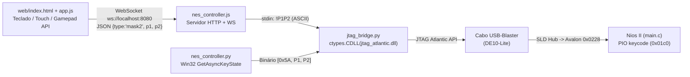

# PC Controller, Site Web e Ponte JTAG UART (`pc_controller/`)

Documentação técnica da camada de host no PC: como a página web e os scripts em Node.js e Python capturam entradas de dois jogadores e enviam os comandos até o softcore Nios II usando a **`jtag_atlantic.dll`** do Intel Quartus Prime.

---

## 1. Fluxo Completo de Comunicação



---

## 2. Como Funcionam os Scripts do Site

### Frontend ([`web/index.html`](web/index.html), [`web/app.js`](web/app.js), [`web/style.css`](web/style.css))

O código no navegador roda sem frameworks externos:

1. **Coleta de Entradas a 60 FPS (`requestAnimationFrame(updateInputs)`):**
   - **Teclado:** Listeners `keydown`/`keyup` rastreiam `pressedPhysicalKeys` usando `e.code` (configuração salva em `localStorage` na chave `nes_dual_bindings`). `Enter` e `NumpadEnter` também acionam `Start` do Player 1. Em evento `blur` (ex.: `Alt+Tab`), todas as teclas e botões virtuais são zerados para evitar botão preso.
   - **Botões na tela (Mouse/Touch):** Eventos `mousedown`/`touchstart` populam `p1TouchButtons` e `p2TouchButtons`.
   - **Gamepads físicos (`readGamepadMask`):** Usa a **HTML5 Gamepad API** (`navigator.getGamepads()`), lendo D-Pad (`buttons[12..15]`), analógico esquerdo (threshold `±0.4` nos eixos `0` e `1`), ação (`0=A`, `1/2=B`) e `Select`/`Start` (`8`/`9`).
   - Cada jogador pode selecionar independentemente a fonte (`keyboard`, `gp0`, `gp1`, `both`), combinando as máscaras por OR lógico bit a bit.
2. **Transmissão WebSocket:** Sempre que o estado muda (ou periodicamente), envia JSON `{ type: 'mask2', p1, p2 }` para `ws://localhost:8080`.
3. **Painel de Cartuchos e Serial:** Consome os endpoints REST do `nes_controller.js` para listar os jogos de `cart_init/games/`, disparar atualização de `.mif` / `.sof` / gravação JTAG e alternar para Serial COM caso selecionado.

### Backend Node.js ([`nes_controller.js`](nes_controller.js))

Escrito 100% com módulos nativos do Node.js (`http`, `crypto`, `fs`, `path`, `child_process`, `readline`), **sem `node_modules`**:

- **Servidor HTTP (porta `8080`):** Entrega os arquivos estáticos de `web/` e expõe as rotas REST:
  - `GET /api/games`: lista o catálogo e o jogo ativo.
  - `GET /api/switch-game?slug=<jogo>&action=<mif|build|flash>`: pausa temporariamente a ponte JTAG, atualiza os `.mif`, opcionalmente compila `NES.sof` (`action=build`) ou grava FPGA + SDRAM (`action=flash`), e religa a ponte ao final.
  - `GET /api/firmware/reload`: pausa a ponte, força download de `usb_controller.elf` na SDRAM e reconecta.
  - `GET /api/quartus/status`: verifica instalação do Quartus e cabos USB-Blaster detectados.
  - `GET /api/serial/ports` e `GET /api/serial/connect`: lista portas COM do Windows e redireciona a saída para um subprocesso PowerShell usando `System.IO.Ports.SerialPort` (modo extra RS-232/DB9).
- **Servidor WebSocket RFC 6455 manual:** Realiza o handshake (`Sec-WebSocket-Accept` via SHA-1), decodifica frames mascarados vindos do browser e devolve mensagens `hardware_status` (conexão da placa, cabo ativo, método atual) e `state2`.
- **Watchdog JTAG (a cada 4s):** Consulta `quartus_pgm -l` para detectar plug/unplug da DE10-Lite e, quando encontra o cabo, carrega `usb_controller.elf` na SDRAM antes de abrir a ponte `jtag_bridge.py`.

---

## 3. Como Acessar a `jtag_atlantic.dll` e o IP JTAG UART

O bloco **IP** (*Intellectual Property*) **`altera_avalon_jtag_uart`** (`jtag_uart_0` no Qsys, endereço base `0x0228`, buffers **FIFO** *First-In, First-Out* de 64 bytes RX/TX) trafega dados seriais encapsulados na própria cadeia **JTAG** de gravação, eliminando conversores USB-Serial extras.

### Por que usar `jtag_atlantic.dll` via Python em vez de `nios2-terminal.exe`?

O `nios2-terminal.exe` conectado por pipes (`stdin`/`stdout`) no Windows sofre bufferização de console e filtragem de caracteres de controle em terminal (TTY). A biblioteca nativa **DLL** (*Dynamic-Link Library*) da Intel **`jtag_atlantic.dll`** (localizada em `<Quartus>/quartus/bin64/jtag_atlantic.dll`) permite leitura e escrita direta nas FIFOs do nó **SLD JTAG Hub** (*System-Level Debugging Hub*, controlador interno da FPGA que compartilha o cabo USB-Blaster).

Como a DLL exporta funções em C++ com nomes decorados pelo compilador MSVC, [`jtag_bridge.py`](jtag_bridge.py) a carrega com `ctypes.CDLL` e faz o binding explícito de 7 símbolos:

| Símbolo Exportado na `jtag_atlantic.dll` | Função |
| :--- | :--- |
| `?jtagatlantic_open@@YAPEAUJTAGATLANTIC@@PEBDHH0@Z` | Abre o canal no cabo especificado (ex.: `"USB-Blaster [USB-0]"`). |
| `?jtagatlantic_wait_open@@YAHPEAUJTAGATLANTIC@@@Z` | Aguarda conclusão do handshake JTAG com a FPGA. |
| `?jtagatlantic_write@@YAHPEAUJTAGATLANTIC@@PEBDI@Z` | Envia bytes para a FIFO RX do IP JTAG UART no Nios II. |
| `?jtagatlantic_read@@YAHPEAUJTAGATLANTIC@@PEADI@Z` | Lê bytes enviados pelo Nios II (`"RDY\n"`, `"OK\n"`). |
| `?jtagatlantic_flush@@YAHPEAUJTAGATLANTIC@@@Z` | Descarrega o buffer de saída imediatamente para reduzir latência. |
| `?jtagatlantic_close@@YAXPEAUJTAGATLANTIC@@@Z` | Fecha e libera o lock exclusivo do cabo JTAG. |
| `?jtagatlantic_get_error@@YA?AW4JATL_ERROR@@PEAPEBD@Z` | Consulta o último código de erro (código `-6` indica canal já em uso por outro processo). |

O Node.js (`nes_controller.js`) inicia `python -u jtag_bridge.py "<cabo>"` como processo filho e escreve linhas no formato **`!<P1_HEX><P2_HEX>\n`** (ex.: `!8001\n`) no `stdin` da ponte, que encaminha os bytes à DLL e devolve no `stdout` qualquer retorno `[NIOS]` lido de volta. Se a ponte Python não puder iniciar, `nes_controller.js` usa `nios2-terminal.exe --quiet` como fallback.

---

## 4. Cliente Console Alternativo ([`nes_controller.py`](nes_controller.py))

Para jogar sem abrir navegador no Windows:
- Lê o teclado diretamente via **`ctypes.windll.user32.GetAsyncKeyState`** a 60 Hz (captura múltiplas teclas simultâneas sem atraso de auto-repeat do sistema operacional).
- Conecta preferencialmente via classe `JtagAtlanticNative` (`jtag_bridge.py`) enviando frames binários `[0x5A, p1_mask, p2_mask]`, com fallback para `nios2-terminal.exe` (formato `!P1P2\n`) ou porta Serial DB9 (`--serial COMx --baud 115200`).

---

## 5. Mapeamento de Bits (Byte de Controle NES)

Cada jogador recebe 1 byte no padrão serial do registrador CMOS 4021 do NES (`keycode[7:0]` = P1, `keycode[15:8]` = P2):

| Bit | Máscara | Botão NES | Tecla Padrão Web (P1) | Tecla Padrão Web (P2) |
| :---: | :---: | :--- | :--- | :--- |
| `7` | `0x80` | **A** | `K` | `Numpad2` |
| `6` | `0x40` | **B** | `J` | `Numpad1` |
| `5` | `0x20` | **Select** | `U` | `Numpad4` |
| `4` | `0x10` | **Start** | `I` (ou `Enter`) | `Numpad5` |
| `3` | `0x08` | **Up** | `W` | `ArrowUp` |
| `2` | `0x04` | **Down** | `S` | `ArrowDown` |
| `1` | `0x02` | **Left** | `A` | `ArrowLeft` |
| `0` | `0x01` | **Right** | `D` | `ArrowRight` |

---

## 6. Comandos de Execução e Diagnóstico

```bash
# 1. Modo recomendado: Interface Web em http://localhost:8080
node pc_controller/nes_controller.js

# 2. Cliente Python direto no terminal
python pc_controller/nes_controller.py --method jtag_uart

# 3. Diagnóstico isolado da DLL jtag_atlantic.dll + IP JTAG UART (5 passos)
python pc_controller/test_jtag_uart.py
```

*(Na raiz do projeto também existem os atalhos [`../run_web_controller.bat`](../run_web_controller.bat), [`../run_python_controller.bat`](../run_python_controller.bat) e [`../test_jtag_uart.bat`](../test_jtag_uart.bat).)*
